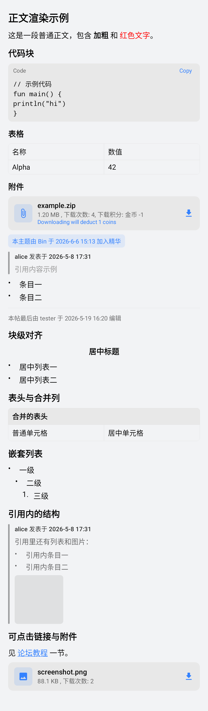
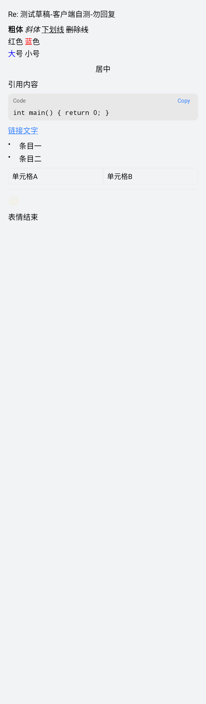
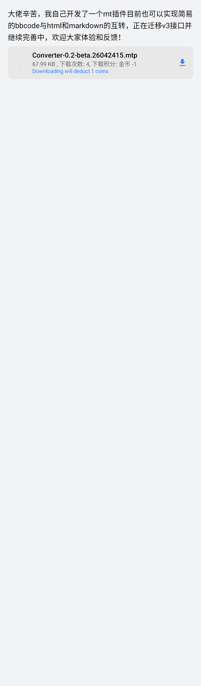

# 交接文档

> MT论坛 客户端 · 包名 `io.rune.mt.forum` · 仓库 https://github.com/Rune-cn/MTForum
> 最后更新 2026-11-27 · 约 209 个 Kotlin 文件 / 18k 行 · 43 个测试 suite / 235 个用例

本文件是接手这个项目的第一入口。读完这一份就能动工；
需要站点细节时再看 [REVERSE_SPEC.md](REVERSE_SPEC.md)，需要找文件时看 [ARCHITECTURE.md](ARCHITECTURE.md)。

---

## 1. 这个项目是什么

`bbs.binmt.cc`（MT论坛）的第三方 Android 客户端。

**为什么不用官方 API**：站点是 Discuz! X + Comiis 移动模板，官方移动 API
（`api/mobile/index.php`）已经下线，全线返回 502。所以所有数据靠解析 HTML 获得。

**为什么不用 WebView**：正文渲染只需要文本、图片、少量行内样式，
用 `AnnotatedString` 原生渲染比套浏览器引擎轻得多，也能跟随主题色。

### 已实现 / 未实现

| 已实现 | 未实现 |
|---|---|
| 版块首页 + Top-10 热度榜 | 会话过期自动重登（见 §12） |
| 导读（全量 + 分页） | 图片上传的进度/多图压缩 |
| 版块列表（标签、缩略图、分页） | 编辑/删除自己的帖子 |
| 帖子详情（楼层、楼主区分） | 点赞列表、@ 提醒 |
| 回复 + 引用上一楼 | 深色模式下部分页面微调 |
| 论坛表情（3 组 257 个） | |
| 账号密码登录 + 会话持久化 | |
| 退出二次确认 | |
| OS3 / OS4 双主题 | |
| **私信（会话列表 + 会话 + 收发）** | |
| **收藏（帖子页一键收藏 + 列表）** | |
| **关注楼主 / 顶（推荐）** | |
| **发新帖（含图片附件上传）** | |
| **帖子内图片点击放大（可缩放）** | |
| **每日签到（连续/累计/今日排名 + 签到按钮）** | |

> 本轮（2026-11-26）新增的 5 个功能对应 REVERSE_SPEC §12–§16，全部按线上实测接口实现。

---

## 2. 架构

```
                   ┌─────────────────────────────┐
   bbs.binmt.cc ──▶│ ForumHttpClient             │  OkHttp
                   │  └ AcwInterceptor           │  挑战页 → 签名 → 重放
                   │  └ Dispatchers.IO           │  阻塞调用切线程
                   └──────────┬──────────────────┘
                              │ HTML
                   ┌──────────▼──────────────────┐
                   │ ForumHtmlParser (jsoup)     │  版块/列表/帖子/楼层/分页/缩略图
                   └──────────┬──────────────────┘
                              │ 领域模型
                   ┌──────────▼──────────────────┐
                   │ ForumRepositoryImpl         │
                   │  ├ ForumCookieJar           │  内存会话
                   │  ├ ForumSessionStore        │  DataStore 持久化
                   │  └ ForumPasswordAuthenticator│  账号密码登录
                   └──────────┬──────────────────┘
                              │ StateFlow
                   ┌──────────▼──────────────────┐
                   │ ForumViewModel              │  首页/列表/帖子/导读/回复
                   └──────────┬──────────────────┘
                              │ Compose State
                   ┌──────────▼──────────────────┐
                   │ Miuix 页面（OS3/OS4 自适应）│
                   └─────────────────────────────┘
```

### 三个独立关注点

1. **反爬**（`AcwSignature` + `AcwInterceptor`）：透明地解决 JS 挑战，上层无感。
2. **解析**（`ForumHtmlParser`）：站点 DOM 的唯一知识来源。
3. **渲染**（`ForumBodyParser` + `ForumHtmlText`）：把 HTML/BBCode 变成 Compose。

任何一层出问题，先定位是哪一层：抓 `ForumHttpClient` 的日志看拿到的是不是真实页面。

---

## 3. 关键机制

### 3.1 反爬 acw_sc__v2

无签名的请求会得到 4 KB 的 JS 挑战页（含 `arg1='<hex>'`），不是内容。
签名算法：

```
acw_sc__v2 = hexXor(unsbox(arg1), KEY)
KEY = "3000176000856006061501533003690027800375"
```

`AcwInterceptor` 检测到挑战页 → 算签名 → 设 Cookie → 重放（最多 3 次）。
实测 2 次即可拿到真实页面。

### 3.2 会话

Discuz 纯 Cookie 认证，核心是 `cQWy_2132_auth`。

**取 uid 的坑**：只能从 `cQWy_2132_lastcheckfeed`（格式 `<uid>|<ts>`）取。

| Cookie | 内容 | 能取 uid 吗 |
|---|---|---|
| `*_lastcheckfeed` | `153466\|1795300445` | ✅ |
| `*_lip` | `222.84.222.7%2C1795299217` | ❌ 是客户端 IP |
| `*_ulastactivity` | `a3e7EBiJGs7...` | ❌ 不透明哈希 |
| `*_comiis_coloruid_153466` | `7s` | ⚠️ uid 在 **cookie 名**里 |

早期用 `lip` 取 uid → 永远 null → 会话判定失败 → **登录明明成功却报「密码错误」**。

**会话失效必须显式判断**：过期 Cookie 访问 `home.php?mod=space&uid=` 会 302 到登录页并返回
**200**。早期用 `title.substringBefore("的广播")` 兜底，而「登录 - MT论坛」不含该串时
`substringBefore` 原样返回整串（非空）→ 未登录被误判为已登录。
现在要求 `span.user_tit` 真实存在。

### 3.3 登录

两步握手（已实测通过）：

```
GET  member.php?mod=logging&action=login          → formhash + loginhash
POST member.php?mod=logging&action=login&loginsubmit=yes&loginhash=…&inajax=1
     字段：formhash, referer=https://bbs.binmt.cc/./, fastloginfield=username,
           cookietime, username, password
```

- 成功：返回 `window.location.href='…'` + 下发 `cQWy_2132_auth`
- **失败也是 HTTP 200**，靠文本判别：`<p>登录失败，您还可以尝试 4 次…</p>`

`loginhash` 实测非强制（带与不带都能成功），客户端保留它因为那是表单原样参数。
失败时把服务端原话（含剩余次数）直接回显给用户。

### 3.4 分页（踩过两次坑）

| 页面 | URL | 备注 |
|---|---|---|
| 版块列表 | `forum.php?mod=forumdisplay&fid={fid}&page={n}` | |
| 帖子 | `thread-{tid}-{page}-1.html` | **页码在第二段** |
| 导读 | `forum.php?mod=guide&view={view}&index=1&page={n}` | 五个 view 共用一套列表 DOM |

⚠️ `thread-{tid}-1-{page}.html` **不报错，静默返回第 1 页**——曾是「加载下一页没反应」的真因。

导读的五个 `view`（`ForumGuideView`）：`newthread` 最新 / `hot` 热门 / `digest` 精华 /
`new` 回复 / `sofa` 抢沙发。它们都渲染与版块列表相同的 `li.forumlist_li`，可直接复用
`parseThreadPage`；分页是真实存在的 `div.pg`（`/ 12 页`），抢沙发没有分页器（单页 12 条）。

### 3.5 正文渲染（2026-11-27 重写）

站点把帖子存成 **BBCode**，Comiis 移动模板在服务端渲染成 **HTML**，所以客户端拿到的是
HTML，任务是**忠实渲染这段 HTML**——不引 WebView、不引第三方富文本引擎。旧实现把
`li/div/table/tr` 全部当段落边界，结果一个 5 行代码块变成 5 个散段、面板与等宽排版全丢
（真实帖子里有 40 个 `comiis_blockcode`，读起来就是一段段散文）。本节记录重写后的块模型。

管线（解析在 `ForumBodyParser.kt`，渲染在 `ForumHtmlText.kt`）：

```
服务端 HTML ──(jsoup)────────▶ 块列表 ──▶ Compose
原始 BBCode ─(bbcodeToHtml)──┘
```

块类型（`ForumBodyBlock`）：

| 块 | 来源 HTML（Comiis 模板） | 渲染 |
|---|---|---|
| `Paragraph` | `div/p/br` + 行内标签 | 15sp 正文，`AnnotatedString` 带 SpanStyle（可选 `textAlign`） |
| `Heading(level)` | `<font size="6\|5\|4\|2">`（常包 `<strong>`） | 20 / 17 / 15.5 / 12.5 sp，Semibold，紧贴上边距 |
| `CodeBlock` | `div.comiis_blockcode > .b_l > ol > li` | 独立面板、等宽、横向滚动、Copy 按钮，**逐行原样保留** |
| `Quote(text, author, truncated, children)` | `div.comiis_quote > blockquote` / 裸 `<blockquote>` | 左侧竖线；作者行（`font color=#999999` 的「…发表于…」）作暗色页眉；**体内列表/表格/代码/分隔线/图片按原顺序成为 `children`** |
| `Divider` | `<hr class="l">` | 1dp 分隔线 |
| `BulletList(items)` | `ul/ol > li`（支持 2–3 层嵌套） | 圆点 / 序号 + 缩进 |
| `Table(rows)` | `table/tr/th\|td`（含 `colspan`） | weight 网格 + 细边框；**表头加粗+底色，`colspan` 变 weight** |
| `Attachment(name, caption, url, iconUrl, previewUrl, isImage)` | `div.comiis_attach`（`span.f_ok`、`p.attach_size`、`a[href*=mod=attachment]`、`img[src*=filetype]`） | 附件卡片，**尾随下载图标 + 文件类型角标；点击弹出"下载/浏览器/复制"选择**（见 §3.9） |
| `ModeratorNote` | `div.comiis_modact` | 蓝色信息 chip |
| `EditNote` | `i.pstatus`（「本帖最后由…编辑」） | 12sp 暗色说明，非斜体 |
| `Picture` / `EmojiRow` | ``（懒加载属性）/ `[#xxx]` token | 全宽图片 / 小表情行（引用内降为 96dp 缩略图） |
| `Aligned(align, blocks)` | `<div align>` / `<p align>` / BBCode `[align=…]` | **块级对齐容器**：内部段落按容器对齐，列表/表格/图片整体按容器对齐 |

服务端实测事实（Comiis 模板对单个 BBCode 标签的输出）：

| 发送的 BBCode | 模板输出 HTML |
|---|---|
| `[b]` `[i]` `[u]` `[s]` | `<strong>` `<i>` `<u>` `<strike>` |
| `[color=#ff0000]` / `[color=blue]` | `<font color="#ff0000">` / `<font color="blue">` |
| `[size=5]` | **服务端丢弃**，文本无样式；正文里的 `font[size]` 来自 `size` 或旧渲染 |
| `[align=center]` | `<div align="center">…</div>` |
| `[quote]`（普通回复里） | 纯文本 + `<br>`，无 blockquote |
| `[quote]`（真正的引用回复） | `div.comiis_quote > blockquote` + `font color=#999999` 作者行 |
| `[code]` | `div.comiis_blockcode > .b_l > ol > li`（每个 `<li>` 一行，可再含 `<br>`/`&nbsp;`） |
| `[url]` | `<a href target=_blank>` |
| `[list][*]` | `<ul><li>` |
| `[table][tr][td]` | `<table><tr><td>` |
| `[hr]` | `<hr class="l">` |
| 表情 | `` |
| 附件 | `div.comiis_attach`（文件名 + 「N KB , 下载次数…」） |

行内样式映射：

| HTML | SpanStyle |
|---|---|
| `strong`/`b` | `FontWeight.Bold` |
| `em`/`i` | `FontStyle.Italic` |
| `u`/`ins` | `Underline` |
| `s`/`del` | `LineThrough` |
| `a` | `primary` 色 + 下划线 + **`LinkAnnotation.Url`（可点击）** |
| `font color` | 解析 hex / 少量颜色名 |

**为什么代码块必须独立成块**：`comiis_blockcode` 的每个 `<li>` 是一行代码，单行里还可能
带 `<br>` 与 `&nbsp;` 缩进。把 `li` 当段落边界就会散架；必须整块取出、按 `<li>`/`<br>`
还原行、`&nbsp;`→空格但**不折叠内部空格**（对齐有意义），只去掉所有非空行共有的公共缩进。
渲染层用 `FontFamily.Monospace + horizontalScroll`，并给「代码 / Copy」按钮复制精确文本。

**HTML vs BBCode 判断**：真实正文是 HTML，代码块里合法地含有字面量 `[b]`/`[i]`/`[url]`；
若对 HTML 跑 BBCode 正则链会把代码改坏。`prepare()` 先判是否含已知 HTML 标签：是则原样交给
jsoup；只有纯 BBCode（客户端外发回复 / 预览响应）才走 `bbcodeToHtml()`。`[code]` 体先抽出
占位并转义 `< > &`，保证 `<app>` 这类字面量原样显示。`[hide]` 仍只显示「此内容已隐藏」。

颜色解析**没有**用 `android.graphics.Color.parseColor`——它在 JVM 单测里是 stub 会抛异常，
被 `runCatching` 吞掉后样式静默消失。已改为自己解析。

本轮（bbcode2）补齐的保真度缺口，每条都能指到一个 fixture：

| 缺口 | 修复 | 证据样本 |
|---|---|---|
| 行内 `<a>` 只有颜色、点不动 | 解析期挂 `LinkAnnotation.Url`（`normalize()` 会重映射注解，否则折叠空白时把链接丢掉）；宿主 `onLinkClick` 可覆盖 | `rich_166223.html`（正文多外链） |
| 表格无表头语义 / 合并列挤成等宽 | 站点「首行整行加粗」视为表头（加粗+底色）；真实 `<th>`/`<thead>` 同样识别；`colspan` 变 weight | `rich_156696.html`（网盘对比表，首行 `<td><div align=center><strong>`） |
| `[align]` 只管段落 | 改为块级 `Aligned` 容器，内部段落与嵌套块都随容器对齐 | `rich_bbcode_reply.html` / `sample_bbcode_reply_page2.html`（`<div align="center">居中</div>`） |
| 列表只到 2 层、`li` 内嵌列表后文字丢失 | 递归收集，深度不设上限；`ul/ol` 之后的文字仍留在父行；纯容器不产生空 bullet | 站点各列表页（`board_44.html` 等每行都有 `li>ul`）；逻辑用合成用例钉住 |
| 引用的截断 `...` 原样显示 | 识别并剥掉服务端 ` ...`，置 `Quote.truncated`，渲染成独立的「站点已截断」行 | `rich_166223.html` 两条长引用 |
| 引用里的 `` 被丢掉 | 图片按**原位置**成为 `Quote.children` 的 `Picture`，渲染为 96dp 缩略图 | 合成用例（站点引用体内暂无图；见下方「诚实缺口」） |
| 引用里的列表/表格/分隔线被拍平 | 引用体走独立 walker，`children` 保留结构 | `sample_bbcode_thread.html` 引用 + 合成 `[quote]` 用例 |

**已知限制（更新）**：嵌套表格仍降级为文本行（可读即可，fixture 里无真实嵌套表格）；
`rowspan` 不参与布局（只保证不丢单元格文字，Discuz `[table]` 本身不产生 `rowspan`）；
服务端已丢弃的 `font size` 无法还原；引用截断按「行尾 ` ...`」判别，站点若改文案需同步调整。

**诚实缺口**：`app/src/test/resources/forum/` 下所有真实线程样本的 `blockquote` 里都没有 ``
（只出现在列表缩略图与楼层正文中）。引用内图片的修复因此由**合成用例**（按站点真实 ``
属性形状构造）+ 站点确实渲染引用图片的行为共同支撑，没有一条真实 fixture 能直接证明它。


用 `ForumRichBodyScreenshotTest` 在 JVM 上渲出的合成样例（标题 / 代码块 / 表格 / 附件卡 /
精华 chip / 带作者引用 / 列表 / 分隔线 / 编辑说明），以及真实回复 `rich_bbcode_reply.html`
（粗体·斜体·下划线·删除线·颜色·居中·代码·链接·列表·表格·hr·表情）的成品：





本轮新增的构造（块级对齐 / 表头与合并列 / 三级嵌套列表 / 引用内结构 / 可点击链接 / 图片附件卡）
都进了同一张 `06_rich_body_constructs.png`；真实 `div.comiis_attach` 卡片（尾随下载图标）单独出一张：



**下载选择面板本身没有截图**：`WindowBottomSheet` 是独立 Dialog 窗口，Robolectric 下
`decorView.draw()` 与 `captureToImage()` 都取不到它的像素（两者都是空白）。面板的可见性由
`ForumRichBodyScreenshotTest` 的断言（「Download to device」「Open in browser」「Copy link」
三个节点均可见）保证，而不是靠一张假截图。

### 3.6 表情

目录来自 CDN 文件 `https://cdn.binmt.cc/data/cache/common_smilies_var.js`：

```js
smilies_type['_12'] = ['默认', 'qq']                                  // 分组：[标签, 目录]
smilies_array[12][1] = [['1240','[呵呵]','qq001.gif','20','20','50']] // [id, BBCode, 文件名]
```

已生成成 Kotlin 常量表 `data/forum/model/ForumSmilies.kt`（3 组 257 个）。
选表情时插入 `[#呵呵]`，服务端会渲染成图片；本地预览也解析同一 token。

**注意**：code 不全局唯一（`[#呵呵]` 在滑稽组和 QQ 组都有），`byCode` 保留首个。

### 3.7 图片（会话感知，2026-11-26 重写）

图片分两类，不能一概而论「公开资源」：

| 类别 | 例子 | 需要什么 |
|---|---|---|
| CDN 静态图 | `cdn.binmt.cc/uc_server/data/avatar/…jpg`、`icdn.binmt.cc/…gif`、`oos.binmt.cc/image/…jpg` | 只要 UA + Referer；**不需要** Cookie |
| 站点代发/附件 | `bbs.binmt.cc/forum.php?mod=image&aid=…`、`mod=attachment` | **必须**带登录会话 Cookie，且要过 acw 挑战 |

`core/image/ForumImageLoader.kt` 里 `buildForumImageHttpClient(cookieJar)` 用**独立的**
OkHttpClient：共用 `ForumCookieJar` + `AcwInterceptor`（由 `App.onCreate` 在 `startKoin`
之后懒解析注入），但**不复用** `ForumHttpClient`（避免带上写路径拦截器和 `forum.php` Referer）。
站点 host 之外的 CDN 不会命中 acw 拦截器（`AcwInterceptor` 对非 `bbs.binmt.cc` 直接放行，
否则每张图都要 `peekBody(64KB)`），Cookie 也只按 host 下发。

URL 规范化统一走 `data/forum/network/ForumUrls.kt`：`//cdn…`、`/data/attachment/…`、
`data/attachment/…` 都转绝对地址；`javascript:`/`file:`/`data:` 返回 null（模板里的图片按钮）。
正文图片加载失败会做一次「CDN → `bbs.binmt.cc` 同路径」重试（Discuz 资源树两边都有），
仍失败则 `Timber.w("picture failed: %s", url)`（只记 URL，不记 Cookie）。

GIF 由 `coil-gif`（API 28+ 用 `AnimatedImageDecoder`，以下用 `GifDecoder`）处理：没有它时
Coil 走 `BitmapFactoryDecoder` 只出首帧，首帧透明的 GIF 看起来就是空白——这是「部分图/头像
像没加载」的次要原因之一，不是主因。

### 3.9 附件下载（2026-11-27 新增）

用户反馈「附件可以选择下载」。旧行为是附件卡只把 `forum.php?mod=attachment&aid=…` 丢给浏览器，
而该地址**是 Cookie 门禁的**：浏览器没登录态就是 403，或者拿到 acw JS 挑战页当文件下载。

**选择面板**：点附件卡弹 `AttachmentChoiceSheet`（`WindowBottomSheet`，真 Dialog 窗口，
不被 `LazyColumn` item 或正文 `SelectionContainer` 裁剪），三行：

| 行 | 行为 |
|---|---|
| 下载到本机 | 走 `ForumAttachmentDownloader`（下面详述），sheet 内显示进度/结果 |
| 在浏览器打开 | `ACTION_VIEW`，`runCatching` 包住（设备可能没有 http(s) 处理者） |
| 复制链接 | `LocalClipboardManager`，行文案切到「已复制」 |

OS4/OS3 分支按铁律 8：OS3 用经典 `WindowBottomSheet`；OS4 的玻璃版本同理可换
`GlassBottomSheet`（同一套 content，`useMiuixOs4` 决定）。

**下载路径**（`data/forum/network/ForumAttachmentDownloader.kt`）：

1. 请求走 `ForumHttpClient.client`（= `ForumCookieJar` + `AcwInterceptor`），
   UA/Referer 与其它请求一致——**绝不**用系统下载器直连；
2. `body.byteStream()` **流式**写盘（64 KB buffer），不整文件进内存；
3. 进度按整数百分比节流回调；`Content-Length` 缺失时回调 `null` → UI 显示不确定进度条；
4. 每轮读取 `ensureActive()`，协程取消能真正中断（`CancellationException` 按「用户取消」处理，
   不显示错误）；
5. 校验：非 2xx 抛 `IOException("HTTP xxx")`；`Content-Type: text/html` 直接判定为挑战页并失败；
   实际字节数 ≠ `Content-Length` 判定为截断并失败。失败时删掉半成品文件，**不留假成功**。

**落盘位置**：`context.cacheDir/attachments/<sanitised name>`——所有受支持 API 级别都无需存储权限，
缓存清扫器（`AutoCacheSweeper`）负责回收。下载完成后 sheet 行变为「已保存到应用缓存」，
并提供「保存 / 分享」：把文件复制到 `getExternalFilesDir()/attachments/` 再走系统分享
（`ACTION_SEND` + `EXTRA_STREAM`）。**没有**新增 `FileProvider`：那会扩大导出面，而
`Android/data/<pkg>/files/` 本身可被分享接收方与 USB 读取。

**文件名安全**：`sanitiseAttachmentFileName()` 替换 `\ / : * ? " < > |` 与控制字符、拆掉 `..`、
去掉前导 `.`（防止生成隐藏文件）、截断到 120 字符、空名回退 `attachment`。
`?key=value` 形状按 URL query 处理，普通文件名里的 `?` 只当保留字符，扩展名不会丢。

**诚实边界**（未在真机验证的部分）：`ACTION_SEND` 是否会因缺少 `FileProvider` 而在某些接收方
失败，只能在真机确认；失败时 `Timber.w` 记录并静默返回，不会崩。
没有加 MediaStore 写公共 Downloads：那需要额外权限/分区存储分支，当前实现用「缓存 + 分享」覆盖
「下载到本机」的诉求，且不需要任何运行时权限。

`ForumThreadPage` 通过 `koinInject()` 取 `ForumHttpClient` 传给下载器（构造参数可注入，方便测试）。

### 3.8 线程模型

`suspend` **不会**自动切线程。所有阻塞调用（`execute()`、jsoup 解析）必须包
`withContext(Dispatchers.IO)`：

- `ForumHttpClient.getHtml/postForm` 内部切 IO
- `ForumRepositoryImpl` 每个公开方法再包一层（覆盖解析开销）

漏掉就会在真机上抛 `NetworkOnMainThreadException`（曾导致首页和导读直接崩）。
`MainThreadSafetyTest` 是静态守卫。

---

## 4. 目录与职责

| 路径 | 文件数 | 职责 |
|---|---|---|
| `data/forum/network/` | 5 | 反爬、Cookie、HTTP、解析 |
| `data/forum/model/` | 1 | 表情目录 |
| `data/forum/repository/` | 3 | 仓库实现、会话持久化、密码登录 |
| `domain/forum/` | 8 | 领域模型 + 仓库接口 |
| `ui/page/forum/` | 14 | 论坛全部页面与组件 |
| `ui/page/login/` | 4 | 登录 |
| `ui/page/miuix/` | 26 | 设置、主题、关于、共享组件 |
| `core/` | 14 | 崩溃、i18n、图片加载、设备信息 |

完整目录树见 [ARCHITECTURE.md](ARCHITECTURE.md)。

---

## 5. 开发约定（违反会出问题）

1. **不要绕过 `ForumHttpClient`**。只有它挂 `AcwInterceptor`，直连 OkHttp 只会拿到 JS 挑战页。
2. **阻塞调用必须 `withContext(Dispatchers.IO)`**。`suspend` 不切线程。
3. **DOM 选择器只在 `ForumHtmlParser`**。改选择器必须同步更新
   `app/src/test/resources/forum/` 的样本与断言。
4. **字符串三语同步**：`values/`(en) + `values-zh-rCN` + `values-zh-rTW`。
   删键必须三处一起删，否则 `lintVital` 报 `ExtraTranslation` 致命错误。
5. **头像统一用 `ForumAvatar`**。不要各自判断 `noavatar` 换字母——
   卡片和帖子内曾因此表现不一致（卡片把 6/10 的头像换成了字母）。
6. **顶栏图标用 `MiuixTopBarIconButton`**。它按 `AppTheme.useMiuixOs4` 分支玻璃/普通样式；
   直接 `IconButton` 会在 OS4 下样式错。
7. **弹窗必须按风格分支**：
   - OS4 → `GlassPopup`（需要**真实的 `anchorBounds`**）+ `GlassPopupItem`
   - OS3 → `WindowListPopup` + `ContextMenuPositionProvider` + `Align.TopEnd`
   `Rect.Zero` 会让弹窗开在窗口左上角；`Align.Start` 会让右边缘按钮的菜单溢出。
8. **图片必须给高度约束**。`AsyncImage` + `fillMaxWidth()` 而没有高度时，
   尺寸未知的图在加载完成前高度为 0，Coil 就没机会显示。
9. **不要条件化 `MiuixComponentHost`**。它的 `Scaffold` 用 `SubcomposeLayout`，
   条件移除会在同帧销毁子组合并崩溃（`Could not resolve state for movable content`）。
10. **禁止日志打印 Cookie 明文**，只可打 uid / isLoggedIn。
11. **提交**：Conventional Commits，主体 ≤72 字符，不加 AI 署名。
12. **预测式返回只有一条实现路径**：动效在
    `ui/animation/predictiveback/MiuixOs4NavTransition.kt`（`miuixOs4NavTransition()`），由
    `appNavTransition(…, useMiuixOs4=…)` 选择；`NavDisplayEffects` 的圆角/压暗也在
    `AppNavContainer` 统一给。**不要**在 NavDisplay 的 entry 里注册常驻 `BackHandler` /
    `PredictiveBackHandler`——那会抢走 `NavDisplay` 自己的手势驱动（= 没有跟手预览）。
    唯一允许的可预测处理器是**菜单展开时**的 `ThreadActionsBackHandler`：必须组合在
    `ThreadActionsGlassMenu` **之后**（navigation-event 调度器优先“最近组合且 enabled”的处理器），
    `enabled = state.expanded`，把 `NavBackEvent.progress` 写进
    `ThreadActionsState.dismissProgress` 驱动面板缩放/淡出；菜单关着时必须 disabled。
13. **首页排行必须是站点顺序**：`parseHotRanking()` 读 `div.comiis_mh_txtlist_phb ul li`
    的文档顺序 + `em` 名次 + `a[title]`，**禁止**客户端按回复/浏览重排（v14 及以前就是错的）。
    导读视图一律走 `ForumUrls.guidePath(view, page)`，不要自己拼 `mod=guide` URL。
14. **深链只有一个入口**：外部 URL 只经 `ui/navigation/ForumDeepLink.kt` 的
    `forumDeepLinkFrom(Uri)` 解析（`ForumDeepLinkState` 负责一次性 hand-off），
    Manifest 的 intent-filter 与 Activity 的 `onNewIntent` 都只调用它，不要再写第二套 intent 解析。

---

## 6. 构建与测试

```bash
bash tools/build.sh                                # debug 冒烟
bash tools/build.sh :app:testStableDebugUnitTest    # 235 个用例（43 个 suite），必跑
bash tools/build.sh :app:assembleStableRelease
bash tools/build.sh :app:lintVitalStableRelease     # 改字符串/资源后必跑
```

工具链与踩坑细节见 [BUILD_ENV.md](BUILD_ENV.md)（JDK 25 / SDK 37.2 / Gradle 9.8.1 / miuix 0.9.5-beta03）。

### 测试覆盖

| 测试 | 覆盖什么 |
|---|---|
| `AcwSignatureTest` | 反爬签名，与 JS 参考实现交叉验证 |
| `ForumParserTest` | 版块索引、帖子列表、楼层、导读 |
| `ForumLoginFormTest` | 登录表单字段、失败响应（200 + 文本） |
| `ForumRichTextTest` | 粗体/斜体/链接/颜色/引用/表情/图片/BBcode |
| `MainThreadSafetyTest` | 静态守卫：阻塞调用必须切 IO |
| `ForumCardRenderTest` | 帖子卡片 **Compose 真实渲染**（Robolectric） |
| `ForumMessagingParserTest` | 私信会话列表/会话详情、收藏、发新帖表单 |
| `ThreadActionsPopupLayoutTest` | OS4 玻璃菜单**像素级锚定**（右缘对齐/不出窗/宿主=整页）+ 截图 |
| `ForumImageUrlTest` | 头像/缩略图 URL 绝对化、占位图过滤、`javascript:` 不拼接 |
| `ForumImageDecoderTest` | GIF→gif 解码器、JPEG→BitmapFactory 的路由断言 |
| `ForumImageSessionTest` | 图片客户端带会话 jar + acw、Cookie 不跨 host |
| `AcwImageFetchTest` | acw 只对 html/xhtml 探测；`image/*` 只取一次、不重放 |
| `ForumBodyImageUrlTest` | 正文图懒加载属性优先于 `src` 占位；`javascript:` 不产生图片块 |
| `ForumHomeRankingTest` | 首页热帖排行：站点顺序/名次/tid/`title` 属性优先，**不重排** |
| `ForumGuideViewsTest` | 五个导读 view 的 URL/枚举顺序/三语标签；热帖/沙发样本解析与分页 |
| `ForumDigestTagTest` | 精华行 `span.bg_c` → `digest=true`、标题去掉「精」/热度徽标；普通行不受影响 |
| `ThreadActionsDismissVisualsTest` | 菜单预测返回变换：p=0 恒等、p=1 淡出、单调且钳制 |
| `ForumDeepLinkTest` | 深链解析：thread/forum HTML、`forum.php?mod=` 查询式、`mtforum://`、非法输入 |
| `ForumDeepLinkNavigationTest` / `ForumDeepLinkActivityTest` / `ForumDeepLinkManifestTest` | 深链导航落点、Activity 冷/热启动一次性 hand-off、合并后 Manifest 的 resolve |
| `OnlineUpdatePolicyTest` | 更新源选择：`mtforum-stable-*.apk` 优先/任意 apk 兜底/校验文件忽略、版本比较、代理 URL |
| `Os4PredictiveBackGeometryTest` | OS4 卡片返回几何：端点、单调、逐帧无跳变、像素对齐、scrim 起手为 0 |
| `Os4PredictiveBackScreenshotTest` | 用真实 transition + 假 `NavTransitionScope` 渲出 p=0.45 的一帧并做像素断言 |
| `ForumImageScreenshotTest` | **JVM 截图**：真实卡片 + 正文渲染、失败占位块落盘 PNG |
| `ForumBodyRichParserTest` | 代码块（DOM 计数/多行/实体还原）、字号标题、`hr` 分隔、表格、附件卡、引用作者、`[code]` 转义 |
| `ForumRichBodyScreenshotTest` | **JVM 截图**：代码块+标题+表格+附件+引用+列表合成图、真实 `rich_bbcode_reply` 回复 |
| `ForumProfileParserTest` | 个人主页：头部/计数/积分/资料行；**二维码行动画层被丢弃**、签名行保留（§17.1） |
| `TopAppBarBackdropTest` | 顶栏采样层守卫 `barBackdrop()`：只接受页面内容层，宿主层被拒（§17.2） |
| `MiuixPageScrollBarTest` | 长列表滚动条覆盖层：贴右缘、满页高、与列表同 padding + 截图（§17.3） |
| `MiuixGroupedCardsTest` | 分组卡片：相邻行无缝相接、保留 12dp 页边距 + 截图（§17.4） |
| `ForumSignInParserTest` | 签到页两份真实样本（签到前/后）的昵称/等级/排名/连续/累计、已签到判定、`formhash` 兜底、CDATA 抽取与 `已签到`/成功/失败映射 |
| `ForumSignInViewModelTest` | 签到卡片状态机：首次加载、签到后刷新数字并保留服务器文案、`已签到`、登录要求、失败不进已签到 |

### 无模拟器时怎么「跑」UI（2026-11-26 新增）

本机跑不了模拟器，用 Robolectric 把真实组件组合出来、**截成 PNG 直接看**：

```bash
bash tools/build.sh :app:testStableDebugUnitTest \
  --tests "io.rune.mt.forum.ThreadActionsPopupLayoutTest"   # OS4 菜单截图
bash tools/build.sh :app:testStableDebugUnitTest \
  --tests "io.rune.mt.forum.ForumImageScreenshotTest"       # 卡片+正文图片截图
```

产物统一在 `app/build/ui-screenshots/`（`ThreadActionsPopupLayoutTest` 的菜单图、`ForumImageScreenshotTest`、
`Os4PredictiveBackScreenshotTest`、`MiuixPageScrollBarTest`、`MiuixGroupedCardsTest`）。仓库里存了样例：
[docs/screenshots/os4-thread-actions-menu.png](screenshots/os4-thread-actions-menu.png)、
[docs/screenshots/os4-thread-actions-predictive-back.png](screenshots/os4-thread-actions-predictive-back.png)
（菜单展开时手势 p=0.5 的关闭预览）、
[docs/screenshots/jvm-image-render.png](screenshots/jvm-image-render.png)、
[docs/screenshots/os4-predictive-back.png](screenshots/os4-predictive-back.png)（页面返回 p=0.45 的手势中间帧）、
[docs/screenshots/os4-page-scrollbar.png](screenshots/os4-page-scrollbar.png)（§17.3 的滚动条覆盖层）、
[docs/screenshots/grouped-card-section.png](screenshots/grouped-card-section.png)（§17.4 的分组卡片）。

⚠️ miuix 的 squircle 用了 AGSL RuntimeShader，Robolectric 自带 Skia 编译不了
（`'color' is not a valid layout qualifier`）。截图测试里用
`CompositionLocalProvider(LocalSquircleEnabled provides false)` 绕开——只影响截图圆角观感，
不影响布局测量。

### 加新页面的检查清单

1. 在 `ui/navigation/Routes.kt` 加 `@Serializable data class/object`
2. 在 `AppNavContainer.kt` 注册 `entry<Route.X>`
3. 页面用 `MiuixPageScaffold` + `rememberMiuixPageChrome()`
4. VM 加到 `di/ViewModelModule.kt`
5. 字符串三语同步
6. 跑测试 + `lintVital`

---

## 7. 已知限制

1. **未在真机运行过**（最重要的一条）。本机无法启动 Android 模拟器
   （沙箱禁止嵌套虚拟化：AEHD 驱动可装且 `emulator-check accel` 报 usable，
   但 qemu 客户机 CPU 时间始终 <2s、永不 boot）。
   UI 用 Robolectric 验证「元素存在且在视口内」，但**验证不了**：
   - 间距与排版的实际观感
   - 滚动流畅度
   - 玻璃模糊（OS4）的真实效果
   - 图片在真实网络下的加载表现
2. **发帖的图片附件未做线上实测**：接口按页面表单实现（multipart `Filedata`，1MB 限制），
   为避免往版面灌测试帖，只验证到「表单解析 + 字段正确」，真实提交需真机确认。
3. **顶（推荐）未做线上实测**：接口不可撤销，实测会给帖子永久 +1，故只实现不实测。
4. **首页「热帖排行」= 站点榜单**：直接解析 `forum.php` 里服务器渲染的
   `div.comiis_mh_txtlist_phb`（10 条，名次在 `em`），客户端不重排、不补作者/回复数。
   （v14 及以前是客户端 `回复×2 + 浏览/10` 算的，和站点对不上，已删除。）
5. **导读分页依赖站点分页器**：`div.pg` 缺失（抢沙发）时按单页处理；若站点改模板去掉
   `div.pg`，会退化为「满页就给下一页」的启发式。
6. **会话过期无自动重登**：表现为只读（能看帖，不能回帖）。
   自动重登需要保存密码，方案见 REVERSE_SPEC §17，尚未实现（当前版本不落盘任何凭据）。
7. **发帖遇验证码会直接拒绝**：站点当前对这几个版块未启用验证码，
   一旦启用，解析器会检测到 `needsCaptcha` 并在 UI 上提示，而不是盲提交。

---

## 8. 下一步优先级

1. **真机验证**（最高优先）。装机后重点看：版块宫格间距、帖子卡片留白、
   表情选择器手感、OS4 玻璃效果、图片加载，以及本轮新增的私信/发帖页。
2. **发帖真实提交 + 图片上传**（接口已就绪，缺真机验证）
3. **会话过期自动重登**（需先决定是否落盘凭据，见 REVERSE_SPEC §17）
4. **提醒页未读态**（站点当前不输出未读标记，拿到真实未读样本后再定）
5. 编辑/删除自己的帖子
6. 深色模式下部分页面微调

---

## 9. 快速排障

| 现象 | 排查方向 |
|---|---|
| 页面空白 / 只有几行脚本 | `AcwInterceptor` 是否拿到签名；打印响应长度（4321 = 挑战页） |
| 帖子「加载下一页」无反应 | URL 是否 `thread-{tid}-{page}-1.html`（页码在第二段） |
| 导读空白 | 选中 view 的 URL 是否经 `ForumUrls.guidePath()`（`view=newthread|hot|digest|new|sofa`）；该 view 是否有帖子 |
| 登录成功却提示密码错 | `cookieUid()` 是否读 `lastcheckfeed`（不是 `lip`） |
| 未登录被当成已登录 | `getUserProfile` 是否校验了 `span.user_tit` |
| 头像/图片不显示 | `ForumImageLoader` 是否带 UA + Referer；图片容器是否给了高度 |
| 站点图床/附件图空白（`mod=image`、`mod=attachment`） | 图片客户端是否拿到 `ForumCookieJar` + `AcwInterceptor`；匿名请求会拿到 4321B 的 acw 挑战页 |
| 个别头像显示成字母 | URL 是否为 `pic/none.png` 占位或 `javascript:;`；`ForumUrls.absolute` 是否返回 null |
| OS4 菜单错位 / 遮罩只盖住按钮 | `GlassPopup` 必须组合在页面根 `BoxScope(fillMaxSize)`，不能放在顶栏 actions 单元格里 |
| 菜单展开时按返回把帖子退掉 | 页面根是否调了 `ThreadActionsBackHandler`（`enabled = state.expanded`） |
| OS4 返回手势「黑闪/硬推/直角」 | 是否走了 `miuixOs4NavTransition`；`dimAmount` 是否 0.2、`cornerClipMode` 是否 All、圆角是否 32dp 兜底 |
| 弹窗开在左上角 | `anchorBounds` 是不是 `Rect.Zero`（没测量） |
| 右上角菜单溢出屏幕 | OS3 是否用 `ContextMenuPositionProvider` + `Align.TopEnd` |
| `NetworkOnMainThreadException` | 阻塞调用是否漏了 `withContext(IO)` |
| `ExtraTranslation` 构建失败 | 三语 strings 键不一致 |

---

## 10. 站点速查

| 用途 | 地址 |
|---|---|
| 论坛首页 | `https://bbs.binmt.cc/forum.php` |
| 版块 | `forum.php?mod=forumdisplay&fid={fid}` |
| 帖子 | `thread-{tid}-{page}-1.html` |
| 导读 | `forum.php?mod=guide&view={newthread|hot|digest|new|sofa}&index=1&page={n}` |
| 热帖排行（首页） | 同在 `forum.php`：`div.comiis_mh_txtlist_phb ul li`（名次 `em`、链接 `a[href]`、标题 `a[title]`） |
| 个人空间 | `home.php?mod=space&uid={uid}` |
| 登录 | `member.php?mod=logging&action=login` |
| 回帖 | `forum.php?mod=post&action=reply&fid=&tid=` |
| 发帖 | `forum.php?mod=post&action=newthread&fid=` |
| 表情目录 | `https://cdn.binmt.cc/data/cache/common_smilies_var.js` |

已知版块 fid：44 综合交流、41 逆向交流、42 编程开发、50 休闲灌水、39 玩机交流、
38 建议反馈、40 求助问答、2 版本发布。

---

## 11. 真机崩溃记录：hwui 栈溢出（2026-11-25）

### 现象

```
signal 11 (SIGSEGV), code 2 (SEGV_ACCERR)
Cause: stack pointer is close to top of stack; likely stack overflow.
name: RenderThread
#00..#512  libhwui.so (computeTransformImpl(DirtyStack const*, Matrix4*)+0/+36)
```

512 帧全部落在 `computeTransformImpl` 的递归里，说明 **RenderNode 层级异常深**（或有环）。

### 结论

崩溃发生在**渲染线程**，与解析、网络、Compose 重组逻辑无关。
当时生效的渲染特性里，唯一会构造 `LayerBackdrop` 并用 `RenderEffect` 回采场景的是
**blur 链路**：

```
rememberMiuixBlurBackdrop(enableBlur)      ← 记录整个子树到 LayerBackdrop
  └ MiuixPageScaffold: Modifier.layerBackdrop(backdrop)  ← 内容录进图层
  └ MiuixTopAppBar: Modifier.textureBlur(backdrop = …)    ← 再从该图层采样
```

容器（pager）和每个页面各自建一层 backdrop，嵌套录制会把同一棵子树反复展开成
RenderNode，刚好就是 `DirtyStack` 链过深的表现。

### 处理

1. **blur 默认关闭**。注意要改两处，只改 `ThemeState` 的默认值**无效**——
   `AppSettingsRepositoryImpl` 里写的是 `prefs[UI_USE_BLUR] ?: true`，那个才是实际默认。
2. **SafeMode 崩溃回环保护**（`core/safemode/SafeMode.kt`）：
   上次运行留下 crash dump 时，本次会话强制不建 backdrop，并把标记写进
   `SharedPreferences`（同步，早于 DataStore 流）。用户在主题设置里重新打开 blur 会清除标记。
   没有这层保护的话，一旦开着 blur 启动即崩，设置被持久化，会形成**永远进不去设置**的死循环。
3. OS4 弹窗（`ThreadActions`）的 `backdrop` 传 `null`：从窗口级浮层采样页面图层是另一种
   制造环的方式。

### 仍未证实

上述是针对渲染线程崩溃的**最可能解释**，但本机跑不了模拟器，**没有实机复现验证**。

如果关掉 blur 后仍然崩溃，说明还有别的 RenderNode 环，排查顺序建议：

1. 逐个页面二分（先只留首页，再加导读/列表/帖子）
2. 关掉 `beyondViewportPageCount = 1`（相邻页面同时组合，各自持有 backdrop）
3. 检查 `MiuixPageScaffold` 的 `layerBackdrop` 与顶栏 `textureBlur` 的层级关系：
   顶栏必须**在图层外**、与之同级，不能落在被录制的子树里
4. 用 `adb shell dumpsys gfxinfo` / `Layout Inspector` 看 RenderNode 深度

### 复现所需信息

再次遇到时请提供：**崩溃前停在哪个页面、做了什么操作**（启动即崩 / 进帖子崩 / 开关 blur 时崩）。
这三者指向完全不同的 RenderNode 路径。

---

## 12. 真机反馈修复：OS4 菜单错位 + 图床/附件图空白（2026-11-26）

两个 bug 都来自真机反馈，本机无模拟器/无设备，因此用 **JVM + Robolectric 截图/像素断言**定位并
验证（见 §6「无模拟器时怎么跑 UI」）。两项修复都有可复现的失败→通过证据，但**都没有真机复核**。

### 12.1 OS4 帖子页右上角三点菜单展开错位

**根因**：`GlassPopup` 不是 `Popup` 窗口，而是**内联 overlay**（`Box(fillMaxSize)` 遮罩 +
`Layout` 用窗口坐标 place 面板，`placeGlassPopup` 把面板钳进 `intersect(window, host)`）。
它被组合在顶栏 `actions` 槽的 `Box` 里 → host 只有按钮单元格大小：
面板被钳到错误一端、遮罩只盖住按钮，而 `Box(fillMaxSize)` 作为 Row 兄弟又把 actions 行撑高，
`onGloballyPositioned` 把跳变后的按钮坐标回写给 `anchorBounds`，形成反馈，最终就是所见「错位」。

**修复**：状态与 anchorBounds 提升成 `ThreadActionsState`（`rememberThreadActionsState()`）；
`ThreadActions` 只画按钮并上报 `boundsInWindow()`；新增 `BoxScope.ThreadActionsGlassMenu()`
在 `ForumThreadPage` 的页面根 `Box(fillMaxSize)` 里组合（OS3 的 `WindowListPopup` 仍留在按钮旁，
保持原锚点）。miuix KDoc 的原话就是 "Place it in the page's root BoxScope"。

**证据**（822×1782 px，真实顶栏 + 真实 ThreadActions）：

| 指标 | 修复前 | 修复后 |
|---|---|---|
| popup host 尺寸 | 798×1782（= actions 行宽） | 822×1782（= 整页） |
| anchor 坐标 | 展开瞬间跳到 (0, −839) | 稳定 (710, 8, 798, 96) |
| 面板矩形 | right=424（跑到左边） | (398, 8, 798, 480)：right=anchor.right，top=anchor.top |

回归测试 `ThreadActionsPopupLayoutTest`（4 个，含一条**反证测试**：把同一批组件放回旧嵌套断言
host≠页面尺寸）与截图 [screenshots/os4-thread-actions-menu.png](screenshots/os4-thread-actions-menu.png)。

### 12.2 站点图床/附件图片加载不出（真机反馈「MT 自带图床的图片不显示」）

**根因**：图片客户端此前刻意「不复用会话」——只带 UA + Referer。CDN 静态图确实不需要登录，
但 Discuz 的附件/图床代理是 **`bbs.binmt.cc/forum.php?mod=image&aid=…` / `mod=attachment`**，
匿名请求返回的是 **200 + 4321B 的 acw 挑战页（text/html）**，Coil 把它当图片解码必然失败。
（对照实测：`cdn/icdn/oos` 三类 CDN 直连 200 `image/jpeg|gif`，带不带 Referer 都一样，所以不是防盗链。）

**修复**：
1. `buildForumImageHttpClient(cookieJar)`：独立 OkHttpClient，共用 `ForumCookieJar` +
   `AcwInterceptor`；`App.onCreate` 在 `startKoin { … }` 之后**立即**取 `ForumCookieJar`（eager，
   没有 `runCatching` 静默降级）再 `SingletonImageLoader.setSafe`，任何图片请求都不会抢跑。
   `AcwInterceptor` 先按 host 放行（非 `bbs.binmt.cc` 不探测），再按 **Content-Type** 只对
   `text/html`/`xhtml` `peekBody(64KB)` 并重放；`image/*` 不缓冲不重放（线上真机链路实测：
   带 acw 后 `mod=image` 返回 `image/gif`）。
2. `ForumCookieJar.loadForRequest` 改为按 `Cookie.matches(url)` 过滤——会话 Cookie 不再泄漏给
   CDN；`AcwInterceptor` 对非 `bbs.binmt.cc` 直接放行（不再对每张图 `peekBody(64KB)`）。
3. 新增 `ForumUrls.absolute()/imageFallback()`：URL 绝对化（`//`、`/`、裸相对路径）与
   `javascript:/file:/data:` 过滤；正文图片失败时 CDN → `bbs.binmt.cc` 同路径重试一次，
   最终失败记 `Timber.w("picture failed: %s")`（只记 URL）。
4. `coil-gif` + 显式注册解码器：GIF 动图；没有它时首帧透明的 GIF 看着就是空白（次要原因）。
5. 占位属性（`comiis_loadimages`/`src=none.png`）不会被当成图片下发（测试锁定）。
6. **懒加载属性优先**：正文 `imageUrl()` 现在按 `comiis_loadimages → file → zoomfile → data-src`
   取真实地址，只有 `src` 不是占位（`none.png`/`imageloading.gif`/`file:`/`data:`/`javascript:`）时才用
   `src`——图床/附件图在正文里是懒加载的，之前读 `src` 只拿到 1px 透明占位。
7. **失败可见**：正文图彻底失败后在占位块中央显示 `⚠ <host>`（并用 `Timber.w` 记 URL），
   用户截图即可指出是哪个域/哪类 URL 失败，无需 adb 或登录。

**测试**：`ForumImageUrlTest` / `ForumImageDecoderTest` / `ForumImageSessionTest` /
`ForumImageScreenshotTest` 覆盖；失败→通过样例：相对头像 `""` → 绝对 URL；缩略图
`data/attachment/...` → `https://cdn...`；`javascript:;` 不再拼成站点 URL。

**真机确认（2026-11-26）**：26.11.2 发布后由机主反馈「已经能用了」——论坛自带图床/附件图
恢复显示。回看根因，最后一块拼图是**正文懒加载属性**（`comiis_loadimages → file → zoomfile →
data-src`），此前只读 `src` 占位，所以 26.11/26.11.1 修了会话与 ACW 也不见好；`mod=image`
的登录态链路仍建议随手回归一次。

### 12.3 已发布 Release

- `26.11`（versionCode 12）：首个修复版，release 签名（**不是 debug 签名**）。
- `26.11.1`（versionCode 13）：在 26.11 上再加固——`AcwInterceptor` 按 Content-Type 门控
  （`image/*` 不探测不重放）、图片 loader 在 `startKoin` 后 eager 注入、Coil ServiceLoader 关闭
  （组件表 debug/release 一致），并新增 `AcwImageFetchTest` 与失败占位截图测试。
- `26.11.2`（versionCode 14）✅ **真机确认可用**：正文懒加载属性优先（图床/附件图空白的主因）
  + 失败占位显示 `⚠ 域名` 便于定位；新增 `ForumBodyImageUrlTest`（84 个测试）。
- `26.11.3`（versionCode 15）：OS4 预测式返回按 Miuix 重做 + 三点菜单规范化 + 导读补齐
  热门/精华/回复/抢沙发 + 首页热帖排行改为站点顺序（详见 §13）。

- 签名密钥**不**入库：本机 `C:\Users\Administrator\Documents\1\secrets\mtforum-release.jks`
  （密码在同目录 `mtforum-release.properties`）；GitHub 侧用 `KEYSTORE_BASE64` 等 4 个 Secrets。
  该文件丢失后无法再签发可升级包，务必备份。

---

## 13. 第三轮真机反馈：OS4 预测返回 / 三点菜单 / 导读五视图 / 首页排行（2026-11-26）

四条反馈来自机主：帖子页三点菜单「不规范」、OS4 预测式返回「不太符合 UI 设计」、
首页「热度排行和论坛主页不符」、导读「只有最新，没有热门/精华/回复/抢沙发」。
本机仍无模拟器/设备，验证方式是几何单测 + Robolectric 截图/像素断言 + 真实站点抓样。

### 13.1 OS4 预测式返回（旧实现为什么不像 Miuix）

旧路径是 `PredictiveBackAnimation.MIUIX -> NavTransitions.MiuixDefault`，在 OS4 下表现为：

* 出页整屏右移、**不缩放**；入页 25% 视差 + `alpha=0.9`（半透明会透出 backdrop 发黑）；
* 圆角只裁 leading 侧（`NavCornerClipMode.Leading`），设备不上报圆角时半径直接是 0 → 直角卡片；
* `dimAmount = 0.5` 的全屏纯黑 scrim，而且库默认 scrim 起手就满 → 手势一按就「黑闪」。

新实现 `ui/animation/predictiveback/MiuixOs4NavTransition.kt`（OS4 + MIUIX 时启用，OS3 与其余
四个选项逐字不变，设置页仍是五项）：

| 量 | 旧 | 新 |
|---|---|---|
| 出页 scale | 1.0 | 1.0 → **0.92** |
| 出页 translationX | 0 → 1 屏宽 | 0 → 1 屏宽（像素对齐，左边缘落整数像素） |
| 出页圆角 | Leading，可能 0 | **四角**，设备圆角或 **32dp** 兜底 |
| 出页阴影 | 无 | **6dp**，静止 0、离位即满值并恒定（阴影贴图不逐帧重算） |
| 入页 | 纯视差 + α0.9 | scale **0.90 → 1.0** + **−6%** 视差，α 恒 1 |
| scrim | 起手即 0.5 | 起手 **0** → 露出 42% 到 **0.2** → 62% 后淡出到 0（提交最后一帧不残黑） |
| settle | 库默认 | commit `Spring(320)`、cancel `Spring(1500)`、返回键 `Tween(300)` |

`push` 仍用库默认动画；`pop` 与 `predictivePop` 共用同一 transition，手势返回与返回键观感一致。

**证据**：`Os4PredictiveBackGeometryTest`（14 个几何不变量：端点、单调性、逐帧无跳变、
像素对齐、拖满完全离屏、RTL 镜像、scrim 起手为 0）；
`Os4PredictiveBackScreenshotTest` 用**真实 transition** + 假 `NavTransitionScope`（`gesture` 非空 →
库自动选 `predictivePop`）渲出手势 p=0.45 的一帧，并对像素做几何校验。
截图见 [screenshots/os4-predictive-back.png](screenshots/os4-predictive-back.png)。

⚠️ 未验证：真机阴影是否渲染、弹簧手感、曲面屏圆角观感（Robolectric 不画 elevation 阴影）。

### 13.2 帖子页三点菜单「不规范」

`GlassPopupItem` 在 miuix 0.9.5-beta03 有 `icon: ImageVector?` 槽（`javap` 确认），
所以菜单用库原生行：图标 + 文字、24dp 图标、20dp 行内边距、全宽按压反馈，行高抬到 **48dp**
（平台最小触摸目标）；**分享**前加一条分隔线（库 `GlassMenuDivider` 的间距/厚度配方）。
OS3 仍是 `WindowListPopup + DropdownImpl`（经典样式只文本）。

返回行为：新增 `ThreadActionsBackHandler(state)` → `BackHandler(enabled = state.expanded)`，
放在页面根。菜单关着时回调 **disabled**，`NavDisplay` 的 `PredictiveBackHandlerWithSessions`
仍是唯一驱动者（不抢手势）；菜单开着时它是最新注册的回调，返回只关菜单、不退帖子。

**测试**：`ThreadActionsPopupLayoutTest` 扩到 8 个（5 个英文标签、48dp、返回关菜单且不退页、
旧的锚定/反证断言保留），截图 [screenshots/os4-thread-actions-menu.png](screenshots/os4-thread-actions-menu.png)。

### 13.3 首页热帖排行（旧算法与站点不符）

旧实现：`getHotThreads()` 实际请求 `mod=guide&view=newthread`（导读最新），UI 再按
`replyCount*2 + viewCount/10` 排序取前 10 —— 既不是站点的榜单，也不是站点顺序。

站点首页 `forum.php` 自带服务器渲染的榜单：

```html
<div class="comiis_mh_txtlist_phb cl"><ul>
  <li class="b_t"><a href="…/thread-177003-1-1.html" title="…"><em class="ibg01 f_f">1</em>…</a></li>
  <!-- 10 条 -->
</ul></div>
```

现在：`ForumHtmlParser.parseHotRanking()` 按文档顺序读 10 条（名次取 `em`、标题优先 `a[title]`、
`em`/标题里的图标字体私用区字形会被清掉），`getHome()` 用**同一个** `forum.php` 请求返回
宫格 + 榜单；UI 原样渲染名次和标题（站点块里只有这两样，不补作者/回复数），
客户端排序与 `HOT_RANKING_SIZE` 全部删除。

**测试**：`ForumHomeRankingTest`（3 个，锁定名次 1–10、真实 tid 顺序、title 属性优先）。

### 13.4 导读补齐五个视图

`ForumGuideView`（最新 `newthread` / 热门 `hot` / 精华 `digest` / 回复 `new` / 抢沙发 `sofa`）
+ `ForumUrls.guidePath(view, page)`；五个 view 共用 `li.forumlist_li` 解析器。
`ForumGuideState(selected, views)` 为每个 view 保存独立的 `ForumListState` 与 job：
切换 tab 不会闪出上一个 tab 的行，已加载的 view 再点即时显示；刷新/加载更多作用于当前 view。
分页用站点 `div.pg`（真实 `/ 12 页`）；抢沙发没有分页器 → 单页 12 条。
UI 是 Miuix `TabRow`（会横向滚动，OS3/OS4 都有选中态），列表沿用 `ForumThreadCard`。

**测试**：`ForumGuideViewsTest`（6 个：URL、枚举顺序、三语标签、热门/沙发真实样本解析、分页）。

### 13.5 验证与发布

- `:app:compileStableDebugKotlin` BUILD SUCCESSFUL
- `:app:testStableDebugUnitTest` BUILD SUCCESSFUL — **21 suites / 112 tests / 0 failures**
- `:app:lintVitalStableRelease` BUILD SUCCESSFUL（三语键同步）
- 发布 `26.11.3`（versionCode 15，release 签名），APK 由 `manual-stable-release` 工作流构建。

---

## 14. 第四轮真机反馈：菜单预测返回 / 关于 / 精华 / BBCode / 深链（2026-11-26）

机主对上一轮的补充与新增需求：「展开菜单没有预见式返回」「删掉关于的调试」「做好关于的更新」
「有些帖子还有精华标签」「做好 bbcode 渲染」「加个深链」。仍是 4 个并行 worktree 实现、合并后统一验证。

### 14.1 展开菜单时的预测式返回（上一轮理解修正）

上一轮把「预测式返回」理解成页面返回动画并重做了 `MiuixOs4NavTransition`（保留，见 §13.1）；
机主实际指的是**三点菜单展开后**：手势返回没有跟手预览，菜单位于 commit 瞬间消失。

- 旧：`ThreadActionsBackHandler` 是普通 `BackHandler(enabled = expanded)`，只有“提交”语义，
  拖动期间没有任何进度；`GlassPopup` 内部自己的 dismiss 处理器也只会在 commit 关菜单。
- 新：`ThreadActionsBackHandler` 改用 miuix-nav 的
  `PredictiveBackHandler(enabled = expanded, onProgress = { collect { dismissProgress = it.progress } })`，
  状态新增 `ThreadActionsState.dismissProgress`；`ThreadActionsGlassMenu` 用
  `Modifier.graphicsLayer` 预览：`scale 1 → 0.92`、`alpha 1 → 0.1`、沿手势边平移 `16dp`；
  commit → `close()`，cancel → 进度归 0。
- **组合顺序是修复的关键**：`ThreadActionsBackHandler` 必须写在 `ThreadActionsGlassMenu`
  **之后**（navigation-event 调度器优先最近组合且 enabled 的处理器），否则 GlassPopup 自己的
  返回处理器会吞掉手势（只关菜单、无预览）。菜单关着时它是 disabled，`NavDisplay` 保持唯一驱动。
- OS3 的 `WindowListPopup` 是真窗口，无法预测；保持“返回即关”，在 KDoc 中写明。

证据：`ThreadActionsDismissVisualsTest`（3 个：p=0 恒等、p=1 淡出、单调/钳制）+
`ThreadActionsPopupLayoutTest` 新增 p=0.5 截图
[screenshots/os4-thread-actions-predictive-back.png](screenshots/os4-thread-actions-predictive-back.png)。

### 14.2 关于页：删掉调试、把更新做成可用

- 删除「调试」分组与「崩溃日志」卡片，同时移除 `AboutState.latestCrashSummary` 与
  `AboutViewModel.loadLatestCrash()`；崩溃文件**写入**逻辑保留（只是不再在关于页展示）。
  三语删除 `debug` / `crash_logs` / `crash_logs_empty`。
- 更新检查原先对本仓库**实际不可用**：`selectOnlineApkAsset()` 只认文件名含 `online` 的资产，
  而本仓库发布的是 `mtforum-stable-<版本>.apk` → 资产为 null → `downloadUrl` 为空 →
  更新弹窗的「下载更新」永远 disabled。
  现在：`mtforum-stable-*` 优先，任意 `.apk` 兜底（忽略 `.sha256` 等校验文件）；
  版本优先取资产名里的 `-<版本>`，回退 tag（去掉 `v` 前缀）；`canCheckUpdates` 去掉自比的
  `packageName` 参数，保留「允许联网 / 非 debug / 非 UNSTABLE」三条。
  `OnlineUpdatePolicyTest` 覆盖稳定资产选择、`26.11.3 > 26.11.2`、`v26.11.3 == 26.11.3`、代理前缀。

### 14.3 列表的「精华」标签

站点精华行在标题锚点里内联 `<span class="bg_c f_f">精</span>`（同槽位还有热度的
`span.bg_a` + 图标字体）。`parseThreadRow()` 现在：`span.bg_c` 含「精」→ `digest = true`；
标题用克隆节点去掉 `span.bg_c/span.bg_a/i.comiis_font` 后再 `cleanTitle()`，避免出现「精」
前缀或私用区乱码。卡片新增 `ForumBadge(精华)`（三语）。
样本 `board_digest.html` 取自真实 `view=digest` 页；`ForumDigestTagTest` 断言 flag、干净标题与普通行。

### 14.4 BBCode 渲染

`ForumBodyParser.bbcodeToHtml()` 原先只认 quote/b/i/u/s/url/code/color/img/hr，其余标签会原样显示。
现在补齐（并保证未知/未闭合标签不再泄漏）：

| 类别 | 标签 | 处理 |
|---|---|---|
| 引用 | `[quote=作者]` | blockquote + 作者粗体行 |
| 列表/表格 | `[list]`, `[*]`, `[table]`, `[tr]`, `[td]` | 转成 `<ul><li>` / `<table><tr><td>`，按块渲染 |
| 隐藏/免费 | `[hide]`, `[free]` | hide 显示「此内容已隐藏」占位（不泄露内容）；free 保留正文 |
| 附件/媒体 | `[attach]`, `[attachimg]`, `[media]`, `[audio]`, `[flash]` | 附件显示「附件」，媒体保留可读 URL |
| 链接 | `[email=]`, `[url=]`（含引号 URL）、`[img=宽,高]` | 链接/mailto/图片 |
| 仅样式 | `[size=]`, `[font=]`, `[backcolor=]`, `[align=]`, `[indent]`, `[float]`, `[p]`, `[md]` | 去标记留文本 |
| 其余 | `postbg/groupid/rate/player/autolink/music` 等 | 去标记 |
| 兜底 | 未闭合/未知 Discuz 标签 | `RESIDUAL_TAG` 统一擦除（不误伤正文里的普通方括号） |

`ForumRichTextTest` 新增 6 个用例（作者引用、列表项、隐藏不泄露、附件/媒体可读、未闭合不泄漏、
size/align/table 去标记）。

### 14.5 深链

- Manifest：`SettingsActivity` 增加 5 组 `VIEW` filter（`thread-*.html`、`forum-*.html`、
  `/forum.php`、`mtforum://thread/…`、`mtforum://forum/…`，DEFAULT+BROWSABLE，未声明 `autoVerify`），
  并设 `launchMode="singleTop"` 让运行中的实例走 `onNewIntent`（否则会再叠一个 Activity）。
- `ForumDeepLink.kt`：`forumDeepLinkFrom(Uri)` 一个纯函数解析全部形态（非法输入返回 null）；
  `ForumDeepLinkState` 负责一次性 hand-off（冷启动 `savedInstanceState == null` 才导航，旋转/重建不重放）。
- `SettingsActivity`：冷启动 + `onNewIntent` 投递；`AppNavContainer` 收到后
  `navigator.replaceAll([Main, route])` 并清空，保证只消费一次。
- 测试：`ForumDeepLinkTest`(16)、`ForumDeepLinkNavigationTest`(4)、
  `ForumDeepLinkActivityTest`(6)、`ForumDeepLinkManifestTest`(3，用 `PackageManager` 解析合并后的 manifest)。

⚠️ 未声明 `assetlinks.json`（站点不在我们控制下），所以 Android 12+ 把 `bbs.binmt.cc` 视为
未验证链接：系统可能仍用浏览器打开，或弹出选择器——这是平台限制，不是应用内跳转失败。
`forum.php` filter 天生宽（intent-filter 不能按 query 过滤），解析器会拒绝未知 `mod`，只停在主页。

### 14.6 验证与发布

- `:app:testStableDebugUnitTest` → **27 suites / 154 tests / 0 failures**
- `:app:lintVitalStableRelease` → BUILD SUCCESSFUL
- 发布 `26.11.4`（versionCode 16，release 签名）。

## 15. 第五轮真机反馈：搜索 / 主页·收藏 / 提醒 / 板块分类 / 帖子页细节（2026-11-26）

机主一次给了 13 条：论坛内搜索、帖子/回复可选取文字、回复样式、删掉帖子内重复的「回复」、
私信输入框随键盘上移、部分板块缺失（版本发布/插件交流/建议反馈/官方公告/申诉举报，补分类）、
查看他人/自己主页、主页「消息提醒」入口（进站点提醒页）、置顶帖子不显示头像、主题默认色贴近
应用图标、查看/删除自己的收藏、显示帖子所属版块、帖子右上角三点菜单要主题设置那种效果。
仍然按 6 个并行 worktree 实现（search / thread / me / theme / boards / notice），合并后统一验证。

### 15.1 论坛内搜索（站点强制登录）

- 入口：论坛首页版块宫格上方的搜索卡片（`forum_search` / `forum_search_hint`）+ 版块列表顶栏
  搜索图标；新路由 `Route.ForumSearch(keyword)`，页面 `ForumSearchPage` + `ForumSearchViewModel`。
- 站点流程（实测）：`GET search.php?mod=forum&mobile=2` 取 `input[name=formhash]` →
  `POST` 同 URL `formhash&srchtxt&searchsubmit=yes&mod=forum&mobile=2&srchfid=all` →
  302 到 `search.php?mod=forum&searchid=<id>&orderby=lastpost&ascdesc=desc&searchsubmit=yes&kw=<kw>&mobile=2`，
  翻页追加 `&page=N`（searchid 与 kw 必须保留）。
- **游客搜索被站点拒绝**（302 登录页 / 「所在的用户组(游客)无法进行此操作」），所以未登录时
  搜索页显示登录卡片、不发请求；请求中途掉登录抛 `ForumLoginRequiredException`，回到登录卡片。
  服务端「搜索间隔」等提示原样展示。
- 结果页复用列表行 DOM（`li.forumlist_li`），fid 从每行自己的 `forum-<fid>-1.html` 取；
  `parseSearch()` 与 `parseThreadRow(li, fid = null)` 共用解析。样本
  `search_results.html` / `search_results_p2.html`（真实「MT管理器」结果，10 行/页、50 页）。

### 15.2 帖子页：可选文字、单一回复入口、楼层与回复框重做

- 正文用 `SelectionContainer` 包裹（仅正文，图片点击仍生效）。
- 删除楼层卡片底部重复的「回复」`TextButton` 与其 `onReply`，回复统一由右下 FAB 打开。
- `ReplyComposer` 重做为 Miuix 组合面板：标题（回复 / 回复 @作者）+ 关闭、引用 chip、
  自动聚焦的多行输入（内部滚动）、表情开关、错误行、发送进度；`imePadding()` +
  `navigationBarsPadding()`；三语化（原先硬编码「回复/取消/发送/表情」）。
  ViewModel 里的中文错误改为资源，服务端原文错误仍原样显示。
- 楼层卡片重设计：36dp 头像、SemiBold 昵称、OP/回复徽章、等级·时间·位置、右侧楼层号、
  细分隔线、OP 用 `surfaceContainerHigh` 高亮并显示版块标签；作者头像/昵称可点进个人主页。
  截图见 [screenshots/os4-thread-post-cards.png](screenshots/os4-thread-post-cards.png)
  与 [screenshots/os3-thread-post-cards.png](screenshots/os3-thread-post-cards.png)。
- 帖子所属版块：`ForumThreadDetail.forumName` 从 `a.kmtit[href*=forum-]`（移动模板）
  / `#pt` / `div.comiis_nav` 面包屑解析，渲染在 OP 卡片顶部。
- 置顶行头像：站点公告条**只输出标题**（`div.comiis_forumlist_top > ul > li` 内
  `<a><em>置顶</em>标题</a>`，实测 30+ 版块全无作者节点），所以列表本身永远没有作者数据。
  处理：
  1) `parseThreadRow(li, fid, pinned = true)` 与该行共用解析，若模板带 byline 就填；
  2) `ForumViewModel.enrichNoticeAuthors()` 对缺作者的行按 tid 并发抓一次线程页，把 OP 的
     昵称/头像/uid/等级补进列表（`noticeAuthors` 缓存，失败不重试到刷新）；
  3) 仍未解析到时卡片显示「置顶」图钉而不是空头像问号。
  样本 `board_pinned_row.html`（带 byline 的变体）+ `ForumParserTest` 断言。

### 15.3 个人主页、我的收藏、消息提醒入口、私信输入框

- 个人主页：`Route.UserProfile(uid, name)` + `ForumProfilePage`/`ViewModel`。
  **注意**：`home.php?mod=space&uid=X` 只是广播壳（feed 走 AJAX），真实资料在
  `do=profile&mobile=2`：头部 `div.comiis_space_info h2` / `div.user_img img` / `span.kmlevs`，
  计数 `div.comiis_space_profileico li a span`（帖子/回复/好友/粉丝/人气），
  积分区 `div.comiis_space_profilejf li`，资料行 `div.comiis_space_profile li div.profile_rs`，
  签名 `div.profile_face`（站点默认「这家伙很懒…」被过滤）；最近发表用
  `do=thread&view=me&from=space`，与版块列表同一套 `li.forumlist_li` 解析。
- 我的收藏：`Route.Favorites` + `ForumFavoritesPage`/`ViewModel`，`getFavoritesPage()`
  返回行 + 页面 formhash（模板只把它印在退出链接里，`parseFormhash` 增加 `formhash=` 兜底），
  行内垃圾桶 → 确认对话框 → `removeFavorite(favid, formhash)`（先 GET 表单再 POST），
  乐观删除、失败回滚 + toast；`type=all` 里的版块收藏被跳过。
- 我的页（设置页第 4 tab）新增「论坛」分组：消息提醒 / 我的收藏 / 我的主页（未登录隐藏）。
  ⚠️ 该分组已在 §15.8 收敛：只剩「我的收藏」，消息提醒改由首页铃铛、我的主页改由点账号头像进入。
- 主页顶栏新增铃铛 `MiuixTopBarIconButton`（`Icons.Rounded.Notifications`）→ `Route.Notices`。
- 私信输入框：Activity 是 edge-to-edge + `adjustResize`，IME 以 inset 到达。Composer 用
  `windowInsetsPadding(WindowInsets.navigationBars.union(WindowInsets.ime))`（取较大值，避免
  imePadding+navigationBarsPadding 叠加），并把它测得的高度加到列表底部 padding，
  使最后一条气泡不被输入框/键盘遮住。

### 15.4 站点「提醒」页

- `Route.Notices` + `ForumNoticesPage`/`ViewModel`：三个 tab
  `view=system`（系统提醒）/ `view=interactive`（坛友互动，即「回复我的」）/
  `view=mypost`（我的帖子）；另有 `view=app`。
- 行结构：`div.comiis_notice_list > ul > li`，`a.notice_img img` 头像，`div.ntc_body`
  内首个 `a[href*=space-uid-]` 作者 + 文案 + 目标 `a[target=_blank]`（href 含 `ptid=<tid>`），
  时间在 `h2.f_d`（需剔除「屏蔽」图标私有区字符）；空态 `div.comiis_notip`。
- **未读标记在真实 13 行里不存在**（全是 `li.b_b.bg_f.cl`），`ForumNotice.unread` 恒 false，
  代码里写明依据缺失，不猜 class。
- 匿名访问一律 302 登录页 → 登录卡片；样本 `notices_{mypost,system,interactive}.html`。

### 15.5 版块宫格补全 + 主题分类

- 首页宫格原先只读快捷宫格（8 个），漏掉只出现在「社区」全量页/快捷发帖选择器里的版块。
  现在 `getHome()` 一次调用内并发取 `forum.php` + `forum.php?forumlist=1`，`parseForums`
  合并三处（快捷宫格 → 全量页 → 快捷发帖选择器，按 fid 去重、**保留站点顺序**），
  得到 12 个版块：42 编程开发 / 41 逆向交流 / 44 综合交流 / 39 玩机交流 / 50 休闲灌水 /
  40 求助问答 / 2 版本发布 / 37 插件交流 / 38 建议反馈 / 46 官方公告 / 53 申诉举报 / 92 站务专区。
  全量页的 `em` 数字是「今日 N」而非主题数，记为 `Forum.todayCount`，不当 threadCount 用。
- 主题分类：`#forumlist_time_li` 的 swiper tab（`forum-<fid>-1.html` = 全部，
  `forum.php?mod=forumdisplay&fid=<fid>&filter=typeid&typeid=<id>`）→
  `ForumCategory(typeId, name)`、`ForumThreadPage.categories`，
  仓库 `getThreads(fid, page, typeId)`；版块页顶栏下 Miuix `TabRow`（可横滑），选中后重载第 1 页、
  分页/下拉刷新保持筛选。抽样中只有 fid 38（建议反馈）当前有分类；无分类版块不显示条。
- ⚠️ 全量页的「MT专区 / 交流与讨论 / 论坛事务」分组名被解析器丢弃，首页宫格未分组；
  需要时再加（先解决 UI 分组的问题）。

### 15.6 主题默认色与三点菜单玻璃效果

- 默认主题色：`PresetColors` 首项 `default` 由橄榄绿 `0xFF4A672D` 改为品牌绿
  `0xFF2E9E5B`（启动图标高亮 `#4ADE80` 压暗后的颜色，与 `ThemeState` 默认 seed 一致），
  「自定义颜色开 + 动态颜色关」时首个色块即应用图标色并被选中；旧橄榄绿 seed 在读取时
  回落到新默认。`ThemePresetColorsTest` 4 个用例守住映射。
  备注：数据层 `AppSettingsRepositoryImpl.DEFAULT_SEED_COLOR` 仍是旧橄榄绿，读取时会被归一化，
  下次清理可统一。
- 三点菜单：`ThreadActionsGlassMenu` 现在取 `currentMiuixComponentScope().pageBackdrop`
  传给 `GlassPopup`（此前 `backdrop = null` 只能opaque 兜底），与主题设置下拉的
  `GlassDropdownPreference(backdrop = scope.pageBackdrop, visuals = GlassPopupDefaults.visuals(style = GlassDefaults.style(AppTheme.isDark)))`
  一致；面板尺寸/圆角/内边距用库默认，预测返回的 `graphicsLayer` 变换与组合顺序不变。
  ⚠️ 真机未验证：`backdrop` 采样自身图层在 Android 16 上有 hwui 风险（§11），
  装机后需开菜单/旋转/复测 logcat；若崩溃则退回 `null` 或把菜单挪到录制层之外。
  **该风险已在真机复现并修正，见 §15.9（改为采样页面内容层 `chrome.backdrop`，不再用 `pageBackdrop`）。**

### 15.7 验证

- 合入 main 后全量复跑（含本轮 §15.8–§15.10 与正文渲染、本地草稿）：
  **41 suites / 222 tests / 0 failures / 0 errors / 0 skipped**；
  `:app:lintVitalStableRelease` → BUILD SUCCESSFUL（`Lint found no new issues`）。
- 分支内验证见各小节。

- `:app:testStableDebugUnitTest` → **36 suites / 192 tests / 0 failures / 0 errors**
- `:app:lintVitalStableRelease` → BUILD SUCCESSFUL（`Lint found no new issues`）
- 新增/更新测试：`ForumSearchParserTest`(2)、`ForumNoticesParserTest`(6)、
  `ForumProfileParserTest`(6)、`ForumFavoritesViewModelTest`(5)、`ForumBoardIndexTest`(5)、
  `ForumBoardCategoriesTest`(4)、`ForumListCategoryStateTest`(2)、`ForumPostCardScreenshotTest`、
  `ThemePresetColorsTest`(4)，以及扩充的 `ForumParserTest`。
- 真机未验证项：搜索键盘/自动聚焦、提醒页未读样式、个人主页与收藏在真实会话下的排版、
  私信 IME inset、三点菜单玻璃（见 15.6）。

### 15.8 设置页入口收敛：消息提醒 / 我的主页（2026-11-27）

机主反馈：「消息提醒不用放设置了吧 设置中的我的主页也去掉吧 点头像就能进主页」。处理：

- **设置页「论坛」分组只剩「我的收藏」一行**（`MiuixPreferredPage`）。删掉
  `notice_entry_title → Route.Notices` 与 `profile_entry_title → Route.UserProfile(uid, name)`
  两行；`SmallTitle(forum_section_title)` 保留（收藏还在，不存在空标题悬挂）。
- **消息提醒**改由首页顶栏铃铛进入（`ForumHomePage` 的 `MiuixTopBarIconButton` +
  `notice_entry_title` 作 contentDescription）——这条路径一直都在，§15.3 已记录。
- **我的主页**改为点设置页账号卡片里的头像 + 昵称/等级区进入：
  `AccountSection(..., onOpenProfile = { user -> navigator.push(Route.UserProfile(user.uid, user.name)) })`。
  该区域用 `Modifier.clickable` + `semantics { contentDescription = profile_entry_title; role = Role.Button }`
  （读屏念「我的主页」）；点击范围只有「头像 + 名字/等级 Column」，**不覆盖右侧退出按钮**，
  退出仍走自己的确认对话框。游客（未登录）卡片 `SignedOutRow` 保持不可点。
- **字符串**：`profile_entry_desc` 在 Kotlin 里已无引用，按三语同步铁律从
  `values/`、`values-zh-rCN/`、`values-zh-rTW/` 一起删除（各 227 → 226 键）。
  `notice_entry_title`（首页铃铛用）、`profile_entry_title`（现在作头像的无障碍描述）
  保留不动。
- 回归测试 `SettingsAccountEntryTest`(5)：头像点击回到登录用户、退出按钮仍弹确认框、
  游客无主页入口、设置页源码只剩收藏行、英文串解析。
- 验证：`:app:compileStableDebugKotlin` → BUILD SUCCESSFUL；
  `:app:testStableDebugUnitTest` → **37 suites / 197 tests / 0 failures / 0 errors**；
  `:app:lintVitalStableRelease` → BUILD SUCCESSFUL。
- 真机未验证项：点头像进主页的实际手感（头像/名字共用一个 12dp 圆角的点击区）。

### 15.9 真机崩溃：三点菜单玻璃采样自环（2026-11-27）

**崩溃签名**（Android 16 / vivo，VERSION 26.11.5；渲染线程，fatal）：

```
signal 11 (SIGSEGV), code 2 (SEGV_ACCERR), fault addr ...
Cause: stack pointer is close to top of stack; likely stack overflow.
name: RenderThread
#00..#512  libhwui.so (android::uirenderer::computeTransformImpl(DirtyStack const*, Matrix4*)+0/+36)
```

**触发**：打开帖子页右上角三点菜单（OS4 玻璃菜单）。这是独立于 §11 blur 录制之外的
**第二个 RenderNode 环**，与「模糊」偏好是否打开无关：OS4 host 本身就会建 backdrop。

**根因**：`ThreadActionsGlassMenu` 把 `MiuixComponentScope.pageBackdrop` 传给 `GlassPopup`。
`pageBackdrop` 是 app 级 host 在**整棵导航树外面**录制的图层（`SettingsActivity`：
`Box(...).then(scope.pageBackdropModifier) { AppNavContainer(...) }`）。而 `GlassPopup` 是
**内联 overlay**（`Box(fillMaxSize)` 遮罩 + 窗口坐标 place 面板，见 §12.1），它本身组合在
同一棵导航树里 → 面板采样了一个**包含面板自己**的图层 → RenderNode 环 → hwui 沿
`DirtyStack` 递归 512 帧 → 渲染线程栈溢出 SIGSEGV。顶栏玻璃不崩，是因为顶栏采样内容层且
它在该录制层**之外**。

**修复**：
- 帖子页把 `chrome.backdrop`（`rememberMiuixPageChrome`，由 `chrome.contentBackdropModifier`
  以 `Modifier.layerBackdrop` 录制在内容 `Box`——`PullToRefresh`/`LazyColumn` 子树——上）
  作为 `backdrop` 参数传给 `ThreadActionsGlassMenu`。
- 纯函数 `threadMenuBackdrop(chromeBackdrop, pageBackdrop)` 是**唯一决策点**：
  `SafeMode.blurDisabled=true` → `None/null`；`chromeBackdrop == null` → `None/null`；
  传入的 chrome 层与 `pageBackdrop` 同一实例（误接）→ `None/null`；否则 → `Content(chromeBackdrop)`。
  `GlassPopup(backdrop = threadMenuBackdrop(...).layer)` 直接使用该结果，没有第二个判断点。
- **为什么不会再有环**：`chrome.backdrop` 的录制范围是页面根 `Box` 内的内容子树；
  `GlassPopup` 组合在外层页面 `Box` 里、作为 `Scaffold` 的兄弟，**不在**该录制子树内 →
  面板不可能采样到包含自己的图层。顶栏（`MiuixTopAppBar(backdrop = chrome.backdrop)`）
  采样同一实例且真机不崩，是经验证据。
- 首版曾按说明改用 `MiuixComponentScope.contentBackdrop`，但本仓库没有任何页面把内容录进
  该层（页面都用 `chrome.contentBackdropModifier` / `chrome.backdrop`），采样它只会退回
  opaque 兜底；现已改为上面的 `chrome.backdrop`。
- `SafeMode.blurDisabled` 在 `Application.onCreate` 里同步读取，**不是**组合状态；因此菜单
  显式判断它。注意：`MiuixComponentHost` 自己的 backdrop 工厂（私有
  `rememberMiuixLayerBackdrop`）目前**不读** `SafeMode`（只有
  `rememberMiuixBlurBackdrop` 读），所以 `useOs4` 不会因 SafeMode 变为 false——不能依赖
  `currentMiuixComponentScope().useOs4` 做这层保护。
- 未改 `MiuixPreferences.kt` 的主题下拉：`GlassDropdownPreference(renderInRootScaffold = …)`
  是真实 popup window，不在录制层内，不构成自环。

**验证**：`ThreadActionsPopupLayoutTest` 的
`menu samples the page chrome backdrop never the page backdrop`：用两个真实
`rememberLayerBackdrop` 实例断言——选中的是调用方传入的 chrome 层、`!==` page 层，
`SafeMode` 命中 → `None/null`，chrome 层缺失 → `None/null`，chrome 槽误接 page 层 → `None/null`。
生产代码里 `backdrop = threadMenuBackdrop(...).layer` 是同一表达式，选择器即唯一决策点
（`GlassPopup` 的内部参数无法在 Robolectric 里反射读取）。

⚠️ **本机无模拟器/无设备，真机复测仍未完成**。若装机仍崩，回退顺序：
1) 菜单传 `null`（纯 opaque 兜底，§11 处理 3）；
2) 把菜单改成真实 popup window（或移出录制层）。

**遗留风险**：`chrome.backdrop` 为 `null` 的情况（`enableBlur=false`、或 OS4 未生效/平台不支持
render effect、或 SafeMode 命中）→ 面板走库的 opaque 兜底，这是可接受的降级；
**真机上的玻璃观感仍未验证**（本机无设备/模拟器），需要装机看「面板是否真的透出列表内容」。

### 15.10 帖子菜单：在浏览器打开

- 帖子页三点菜单新增「在浏览器打开」（复用三语键 `thread_action_open_browser`），
  顺序：收藏 / 顶赞 / 关注楼主 / 复制链接 / 在浏览器打开 / 分享；分享仍在最后一行，
  菜单「最后一行前画分隔线」的语义不变。
- 打开 `https://bbs.binmt.cc/thread-<tid>-1-1.html`（`Intent.ACTION_VIEW`），用 `runCatching`
  兜住「设备没有可处理 http 的 Activity」等失败，只 `Timber.w`，不崩。
- 测试：`ThreadActionsPopupLayoutTest` 的 label 用例扩到 6 行并断言纵向顺序
  （in-app 动作在前、系统分享最后）；README 功能表同步。

**验证（含第二轮 `chrome.backdrop` 修正后复跑）**：

- `:app:compileStableDebugKotlin` → BUILD SUCCESSFUL
- `:app:testStableDebugUnitTest` → BUILD SUCCESSFUL，**36 suites / 193 tests / 0 failures / 0 errors**
  （`menu samples the page chrome backdrop never the page backdrop`；label 用例 6 行 + 顺序断言）
- `:app:lintVitalStableRelease` → BUILD SUCCESSFUL（`Lint found no new issues`）
- 合入 main 后复跑：**41 suites / 222 tests / 0 failures / 0 errors**（与正文渲染、本地草稿一起）。
- ⚠️ 本机无设备/模拟器：真机上「菜单不再崩溃」与玻璃观感**均未复测**。

---

## 16. 草稿（发帖 / 回复）— 2026-11-27

用户一开始就说过「论坛有自带的草稿啊」，上一轮判断「站点没有草稿」**是错的**。复测后确认：
站点有真·服务器草稿，本机存储只作为离线兜底保留。§16.1 是修正后的实测事实，
§16.2 起是客户端的实现。

### 16.1 站点「保存草稿」实测（修正后）

发帖/回复表单里都有这一对：

```html
<input type="hidden" id="postsave" name="save" value="" />
<button type="button" id="postsubmit" onclick="document.getElementById('postsave').value=1;$('postsubmit').click();"><em>保存草稿</em></button>
```

「保存草稿」不是独立接口，只是把 `save` 设成 `1` 后提交**同一个表单**：

| 请求 | 结果 |
|---|---|
| `save=1`（带/不带 `topicsubmit=yes`） | **建立真实草稿** `thread-<tid>` |
| `save` 为空 / 缺省 | **发表**（草稿变公开主题） |

草稿与普通主题的可见性差异（这几条是判据，也是上一轮踩错的原因）：

- **不进版面列表**：`forum-<fid>-1.html` 里搜不到该 tid；
- **匿名看不到**：匿名 GET 该草稿的线程页返回空/拒绝页；
- **作者本人可见**：登录作者打开正常渲染，且带 `<span class="top_jg bg_a f_f">草稿</span>` 徽标；
- **出现在草稿列表**里。

> 上一轮「`save=1` 会直接发布」的结论是**漏发 `save` 字段**造成的：只发了
> `topicsubmit=yes`，于是走了发表分支。判据就是 `save` 有没有值。

### 16.2 站点接口（客户端实现的全部地址）

```
草稿列表    GET  forum.php?mod=guide&view=my&type=thread&filter=save&fid=0&mobile=2[&page=N]
存新帖草稿  POST forum.php?mod=post&action=newthread&fid={fid}&extra=&topicsubmit=yes&mobile=2
             字段：formhash, posttime, subject, message, htmlon=0, usesig=1, allownoticeauthor=1, save=1
             附件：Filedata（multipart，可多个）
存回复草稿  POST forum.php?mod=post&action=reply&fid={fid}&tid={tid}&extra=page%3D1&replysubmit=yes&mobile=2
             字段：formhash, message, replysubmit=yes, save=1[, noticeauthor]
打开草稿    GET  forum.php?mod=post&action=edit&fid={fid}&tid={tid}&pid={pid}&page=1&mobile=2
发表        POST 编辑表单自己的 action，save=（空）, delete=0
再存草稿    POST 同上，save=1
删除草稿    POST 同上，delete=1
```

**编辑表单必须整份回放**：服务端会拒绝/静默忽略只手搓的最小字段集。客户端从
`form#postform` 里把每个 input/textarea/select 都收进 `ForumEditForm.fields`（`htmlon` 虽然
`disabled` 也保留，Discuz 需要它；未勾选的 checkbox 不收，浏览器也不会提交），再由
`ForumDraftServiceImpl` 在 `fields` 的副本上改一个字段就发出。字段名：
`formhash / posttime / delete / fid / tid / pid / page / editsubmit / subject / message /
htmlon / usesig / save`（另有 `hiddenreplies`、`ordertype` 等可选 checkbox）。

### 16.3 客户端实现

- **领域层**：
  - `domain/forum/model/ForumDraft.kt` — `ForumDraft`（列表行）、`ForumDraftPage`、
    `ForumEditForm`（编辑表单 + 全量字段）、`ForumDraftEdit`（打开发帖页后的subject/message）、
    `DraftActionResult`（Success/Failure）；本机兜底模型 `ForumNewThreadDraft` / `ForumReplyDraft`
    / `ForumDraftIndex` 仍在同一文件。
  - `domain/forum/repository/ForumDraftRepository.kt` — `ForumDraftService`（站点草稿读写）+
    `ForumDraftRepository`（本机兜底）。
- **数据层**：`data/forum/repository/ForumDraftServiceImpl.kt`，所有阻塞调用包在
  `withContext(Dispatchers.IO)`，HTTP 一律走 `ForumHttpClient`（含 multipart 的 POST 复用
  `postMultipart`），因此 `AcwInterceptor` 反爬照常生效。
- **解析**：`ForumHtmlParser.parseDraftPage`（列表行）、`parseDraftEdit`（编辑表单 + 字段收集）、
  `draftThreadPid` / `isDraftThread`（线程页的 pid 与草稿徽标）。DOM 选择器只在这一个文件里。
  URL 拼接在 `ForumUrls.draftListPath` / `draftEditPath`。
- **本机兜底（`ForumDraftRepositoryImpl`，DataStore `forum_drafts`，上限 20 条）**：
  **只在两种情况下写**——站点保存失败（把文字留住，并显示站点的原始错误）、以及提前离开页面
  （`saveOnLeave()`，只写本机、**绝不发网络请求**）。站点保存成功后会删掉本机副本。
  图片仍只存 content URI。
- **页面**：
  - `ui/page/forum/ForumDraftsPage.kt` + `ForumDraftsViewModel.kt` — 草稿列表（下拉刷新 + 翻页 +
    登录卡片 + 删除确认）；行点击进发帖页编辑。
  - `ui/page/forum/NewThreadPage.kt` / `NewThreadViewModel.kt` — 发帖页新增 `ComposerMode`：
    新建模式（`保存草稿` = `save=1` 建草稿；`发布` = 正常发表）与草稿编辑模式
    （`保存草稿` = 对同一草稿 `save=1` 再存，`发表` = `save` 空发布，`删除` = `delete=1`）。
    草稿模式下两个破坏性动作（发表/删除）都走 `MiuixConfirmDialog` 二次确认。
  - `ui/page/forum/ReplyComposer.kt` / `ForumViewModel.saveReplyDraft()` — 回复框的 `保存草稿`
    改成 POST 站点（`save=1`），失败时保留文字 + 写本机兜底 + 显示错误。
- **路由/入口**：`Route.Drafts`（`AppNavContainer` 注册 `ForumDraftsPage`，
  `ViewModelModule` 注册 `ForumDraftsViewModel`）。入口放在**设置页「论坛」分组**、
  「我的收藏」下面一行。理由：草稿和收藏一样是「登录账号自己的论坛数据」，设置页这一组正是这个
  语义；发帖页顶栏再放一个会和「保存草稿」按钮语义重叠，反而是杂音，所以没加。
- **服务端草稿优先**：发帖页打开时会拉一次草稿列表，同版块有站点草稿时用站点草稿（提示文案也会
  说明来源），只有站点没有时才用本机兜底副本。回复框因为草稿列表是 `type=thread` 的
  （不含回复草稿），仍以本机副本作为恢复路径。

### 16.4 验证

- `:app:compileStableDebugKotlin` → **BUILD SUCCESSFUL**
- `:app:testStableDebugUnitTest` → **BUILD SUCCESSFUL，42 suites / 237 tests / 0 failures /
  0 errors / 0 skipped**（基线 main 是 41/222，本次新增 1 个 suite：`ForumDraftParserTest` 10 个用例，
  并把 `ForumDraftViewModelTest` 改写成 15 个用例覆盖站点草稿流程）
- `:app:lintVitalStableRelease` → **BUILD SUCCESSFUL**（`Lint found no new issues`，
  1 个既有错误由 `lint-baseline.xml` 过滤）；三语字符串各 **249** 键，数量一致。
- ⚠️ 本机无设备/模拟器：**没有**在真机上点过草稿列表/发表/删除；也**没有**再对
  `bbs.binmt.cc` 发真实请求（用户明确禁止，实测事实来自用户提供的一次验证）。

### 16.5 限制（如实）

- 草稿列表行**不含 pid**，所以「打开发帖页」是两步：先 GET 编辑页拿 pid 与字段集。多一次往返。
- **回复草稿不出现在草稿列表里**（该列表是 `type=thread`），所以回复草稿一旦站点保存，
  客户端目前没有「列表入口」能再次打开它——只有再次进入同一帖子的回复框时，仍靠本机副本恢复。
  这是已知缺口。
- 草稿正文按 BBCode 原样恢复（站点 textarea 里就是 BBCode），不做 HTML 反渲染。
- 图片附件：新帖草稿的图片以 `Filedata` 一并 POST；草稿编辑页的既有附件不在客户端恢复
  （只恢复文字），附件区块显示为服务端原样。
- 本机兜底上限 20 条是硬编码常量，被淘汰的兜底副本不可恢复（站点草稿不受影响）。
- 发表/删除是不可逆操作，客户端只做了二次确认，没有额外撤销。

---

## 17. 每日签到（2026-11-27）

### 17.1 站点事实（详见 REVERSE_SPEC §22）

- 入口：首页「每日签到」卡片 → `k_misign-sign.html`（插件 `k_misign`）。
- 页面一屏给全：头像 `div.user_img img`、昵称 `h2.fyy`、`p.fyy.comiis_tm`（`签到等级 Lv.8`）、
  三行统计 `div.comiis_qdinfo ul li`（今日排名 / 连续签到 / 累计签到）、
  `a#signresult`（签到按钮）、补签链接、`div#ranklist`（排行榜，AJAX 填充）。
- 签到接口只有一个 GET：
  `plugin.php?id=k_misign:sign&operation=qiandao&format=text&formhash={formhash}`，
  返回 XML 包 CDATA（`<![CDATA[已签到]]>`），CDATA 文本就是给用户的结果。
- 游客被 302 到登录页；`formhash` 只在退出链接里（`parseFormhash` 兜底）。
- 签到后按钮变成 `已签到`（无 id），计数只在**重新取页**后才更新——接口不返回数字。

### 17.2 实现

| 层 | 位置 | 内容 |
|---|---|---|
| 模型 | `domain/forum/model/ForumSignIn.kt` | `ForumSignInState`（含 `formhash`、`resultMessage`）+ `sealed interface ForumSignInOutcome`（Success / AlreadySigned / Failure） |
| 解析 | `ForumHtmlParser.parseSignInState` / `parseSignInOutcome` / `parseCdataMessage` | DOM 选择器仍只在 parser；CDATA 抽取一处实现 |
| 仓库 | `ForumRepository.getSignInState()` / `signIn(formhash)` | 均 `withContext(Dispatchers.IO)`；游客抛 `ForumLoginRequiredException`；签到结果按文案分类 |
| VM | `ui/page/forum/ForumSignInViewModel.kt` | 一次取页 + 签到后**再取一次页**刷新数字；`message` 是服务器原文（一次性 snackbar） |
| UI | `ui/page/forum/ForumSignInCard.kt`，挂在 `MiuixPreferredPage` 账号区块下方 | 已签到/未签到标题、三格统计、`签到` 按钮（已签到则禁用并显示「今日已签到」）、刷新、错误行；游客显示登录卡片 → `Route.Login` |

**形状选择（为什么是卡片而非独立页）**：整个功能就是三个数字加一个按钮，设置页本来就有账号
区块；做成独立页会为一次点击多一次导航，而且要多注册一条 route。卡片挂在账号区块下，
「我的」页一进来就能看到状态。VM 仍注册在 `di/ViewModelModule`。

**已经签到不是错误**：`已签到` 映射成 `AlreadySigned`（卡片标记完成 + 原样 snackbar），
只有权限/登录/限流等文案才是 `Failure`（红字 + snackbar）。

**成功文案是宽容映射**：实测账号当天已签到，只观测到 `已签到`。因此「非错误、非已签到」一律
按 `Success` 处理，并把服务器原文原样给用户——不臆造「签到成功」这种客户端文案。

### 17.3 验证

- `:app:compileStableDebugKotlin` → BUILD SUCCESSFUL。
- 分支内：`:app:testStableDebugUnitTest` → **43 suites / 235 tests / 0 failures**（基线 41 / 222；
  新增 `ForumSignInParserTest` 8 例、`ForumSignInViewModelTest` 5 例）。
- **合入 main 后全量复跑（含站点草稿 §16、正文保真与附件下载 §3.5、示例应用对齐 §18）：
  48 suites / 278 tests / 0 failures / 0 errors / 0 skipped**。
- `:app:lintVitalStableRelease` → BUILD SUCCESSFUL（`Lint found no new issues`）。
- 新增 12 个字符串键三语同步（`sign_in_*`），三处均 248 键。
- 样本：`signin_misign.html`（签到前）、`signin_misign_after.html`（签到后，1033 / 3 天 / 272 天）。

### 17.4 限制（如实）

- **成功文案未实测**：账号当天已签到，只观测到 `已签到`；`Success` 是按「非错误」推断的宽容映射，
  真机首次签到请核对 snackbar 文案与卡片数字刷新。
- **排行榜（`div#ranklist`）未实现**：它由 `ajaxlist('today')` 另一条 AJAX 填充，本轮不做。
- **补签未实现**：只记录入口地址（`home.php?mod=magic&mid=k_misign:k_misign_bq`），
  它走道具（魔法）流程，会消耗站点道具，未做。
- 签到状态不落盘（每次进设置页取一次页），符合「签到状态是抓取的，不缓存」。

---

## 18. 对齐官方示例应用（Miuix `example/`）— 2026-11-27

参考实现：`compose-miuix-ui/miuix` 的 `example/shared/src/commonMain/kotlin/`（本机只读检出在
`miuix-ref`）。本次不做整块重写，而是拆成 5 个可单独验证的改动，每个一个 commit。

### 18.1 个人主页去掉二维码行（用户请求 1）

站点在第一个 `div.comiis_space_profile` 里多印一行 二维码：

```html
<li class="b_t">
  <a href="javascript:;" class="profile_a profile_ewmbox">
    <div class="profile_rs"><i class="comiis_font f_d">…</i><i class="comiis_font profile_ewm f_d">…</i></div>
    <span>二维码</span>
  </a>
</li>
```

该行是**模板 JS 的二维码浮层入口**（`href="javascript:;"`），HTML 里没有任何可渲染的值——
`div.profile_rs` 里只有两个 icon-font 私有区字符。客户端此前把它当普通资料行，结果是多出一行空的
「二维码」。**在解析层丢弃**（`ForumHtmlParser.parseUserProfile`，判据 `a.profile_ewmbox, .profile_ewm`），
因为渲染层无法用“空值”判断该不该渲染——那会连带吞掉站点上真正空值的字段。

- 文件：`app/src/main/java/io/rune/mt/forum/data/forum/network/ForumHtmlParser.kt`
- 不改：签名行（`div.profile_face`，它在同一块里且**紧邻**二维码行）、用户ID/生日/性别/在线时间/
  注册时间/最后访问等真实字段
- 测试：`ForumProfileParserTest.qr code overlay row is not surfaced as a profile field`
  （两个 fixture 都断言没有「二维码」行、`space_profile.html` 的 6 个真实字段顺序不变、
  `space_profile_own.html` 的签名仍然解析出来）

### 18.2 顶栏采样层守卫（示例 `MainPage.kt` + `utils/PageUtils.kt`）

示例的模型是：`MainPage` 在 **Scaffold 内容里**的 `Box` 上挂 `Modifier.layerBackdrop(backdrop)`，
再把同一个 backdrop 交给 `Scaffold` 的 `topBar` 里的 `BlurredBar`。也就是说**顶栏采样的层里没有顶栏**。

本仓库此前结构上已经是这样（`MiuixPageChrome.contentBackdropModifier` 只挂在滚动容器上），
但**没有任何地方阻止**把宿主层 `MiuixComponentScope.pageBackdrop`（`SettingsActivity` 绕整棵导航树
录制的那一层）塞进顶栏——那正是 §11 / §15.9 的 RenderNode 自采样环。本次加了一个**唯一决策点**：

```kotlin
internal fun barBackdrop(contentBackdrop: LayerBackdrop?, hostBackdrop: LayerBackdrop?): LayerBackdrop?
```

`MiuixTopAppBar` 的三个分支（OS4 渐进模糊、OS4 普通玻璃、OS3 `miuixBlurEffect`）现在都只读它，
非法层降级为不透明顶栏而不是崩溃。

- 文件：`app/src/main/java/io/rune/mt/forum/ui/page/miuix/widgets/MiuixTopAppBar.kt`、
  `MiuixPageScaffold.kt`（补上分层模型的 KDoc）
- 测试：`TopAppBarBackdropTest`（内容层通过、宿主层被拒、无层兜底）；
  既有 `ThreadActionsPopupLayoutTest` 10 例全绿（菜单安全不变）

### 18.3 长列表滚动条（示例 `MainPage.kt` / `SettingsPage.kt` / `ComponentPage.kt` / `PullToRefreshPage.kt`）

示例的每个长列表都在内容 `Box` 里叠一个
`VerticalScrollBar(rememberScrollBarAdapter(listState))`；`PullToRefreshPage.kt` 证明它和下拉刷新
**可以共存**，因为它是列表的**兄弟**而不是外层包装。

本应用此前没有任何滚动条，帖子页一屏好几楼、根本没法预判位置。新增统一覆盖层：

- 文件：`app/src/main/java/io/rune/mt/forum/ui/page/miuix/widgets/MiuixScrollBar.kt`（新）
- 接入：`MiuixPageScaffold`（设置页/主题页/首页/导读等全部经此）、
  以及自带 `Scaffold` 的 `ForumThreadPage` / `ForumListPage` / `ForumNoticesPage` /
  `ForumFavoritesPage`（它们必须把列表包进 `PullToRefresh`，所以拿不到 helper，改动形状与示例相同）
- 契约：`trackPadding` 用列表自己的 `contentPadding`，`topAppBarScrollBehavior = chrome.scrollBehavior`
  ——滚动条不会钻到顶栏或悬浮导航栏下面
- 测试：`MiuixPageScrollBarTest`（3 例）＋截图
  [docs/screenshots/os4-page-scrollbar.png](screenshots/os4-page-scrollbar.png)

### 18.4 分组卡片（示例 `component/GroupedCardItems.kt`、`component/CardSection.kt`）

示例把同一段落的连续行画成**一张卡片**：首行留上圆角、末行留下圆角、中间行是直角，圆角半径取自
`CardDefaults.CornerRadius`；`Card` 只有一个 `cornerRadius` 参数表达不了四角，所以示例用
`squircleSurface`。本次原样移植成 `MiuixGroupedCards.kt`（`MiuixCardSegment` +
`LazyListScope.miuixGroupedItems`，含示例那条「不透明缝补 2px」的处理，防止 0.5x 降采样时出现黑缝）。

两处改动落地：

1. **首页热帖排行**：原先是 10 张独立 `Card`，每张 `padding(bottom = 10.dp)`；站点本身是**一整块**
   排行列表，现在是一张分组卡（行内只剩名次 + 标题）。名次/顺序/前三天色徽标均不变。
2. **帖子楼层卡**（`ForumPostCard`）：原先是手写
   `clip(RoundedCornerShape(18.dp)).background(surfaceContainer*)`，现在改用 Miuix 自己的
   `Card` + `CardDefaults.defaultColors()`，圆角与 squircle 裁剪回到库的 16dp 约定。
   `insideMargin = 0` 保留，因为署名行与正文各自有显式 padding（正文图片/表格要通栏）。

- 文件：`app/src/main/java/io/rune/mt/forum/ui/page/miuix/widgets/MiuixGroupedCards.kt`（新）、
  `app/src/main/java/io/rune/mt/forum/ui/page/forum/ForumHomePage.kt`、
  `app/src/main/java/io/rune/mt/forum/ui/page/forum/ForumThreadPage.kt`
- 测试：`MiuixGroupedCardsTest`（3 例：相邻行 y 相接、页边距保留、截图
  [docs/screenshots/grouped-card-section.png](screenshots/grouped-card-section.png)）；
  `ForumPostCardScreenshotTest` 重新出图
  [docs/screenshots/os4-thread-post-cards.png](screenshots/os4-thread-post-cards.png)

### 18.5 顶栏动作：**没有**迁移到 `GlassPopupAnchor`

示例的 OS4 顶栏动作用 `GlassIconButton` + `Modifier.glassPopupAnchor(anchor, …)` +
`GlassTransformPopup`/`GlassIconDropdownMenu`。本应用的帖子菜单用的是
`ThreadActionsState.anchorBounds`（`boundsInWindow()`）+ 内联 `GlassPopup`。

**结论：保留现有实现**，理由（文档 + 实测对照）：

- `GlassPopup` 的官方契约**就是** `anchorBounds: Rect`（窗口坐标），见
  `docs/zh_CN/components/glass/glasspopup.md` 属性表第一项。现有代码用的正是这个 API，
  不是自造替代品。
- `glassPopupAnchor` 是 `GlassTransformPopup` / `GlassIconDropdownMenu` 的锚点工厂，它额外做
  「展开时隐藏原控件、复制控件外观做变换」。帖子菜单是**纯列表**（6 行动作），没有可变换的锚点内容，
  换成 `GlassIconDropdownMenu` 就必须把所有行改造成 `DropdownEntry`/`DropdownItem`，会丢掉
  `GlassPopupItem` 的 icon slot 与 48dp 触控目标（§15.9 已就此单独验证过）。
- 更关键的是崩溃面：`GlassTransformPopup` 需要一个 **backdrop**，而示例给它的是页面背景层
  （`PageUtils.kt` 里 `rememberBlurBackdrop` 的 `backdrop`）——在我们这里等价于
  `MiuixComponentScope.pageBackdrop`，也就是 §11/§15.9 那个**包含菜单自身**的层。
  现有实现刻意只给它 `chrome.backdrop`（内容层），并留了 `threadMenuBackdrop()` 的显式拒绝。
  为了“对齐示例”而把采样源换成页面层，等于重新引入已确证的渲染线程崩溃。
- 风险不对称：迁移只带来视觉变换动画，代价是重写已验证的安全边界。**不做**。

仍然保留：`ThreadActionsBackHandler`（`PredictiveBackHandler(enabled = expanded)`）与
`ThreadActionsGlassMenu` 在页面根 `BoxScope` 的组合顺序（§15 / AGENTS 规则 15、23）。

### 18.6 验证

- `:app:compileStableDebugKotlin` → BUILD SUCCESSFUL
- `:app:testStableDebugUnitTest` → **44 suites / 232 tests / 0 failures / 0 errors**
  （基线 41 / 222，新增 3 个 suite / 10 个用例）
- `:app:lintVitalStableRelease` → BUILD SUCCESSFUL（无新增 lint 错误）
- 未做设备验证（本机无模拟器），UI 结论全部来自 Robolectric 几何断言 + 截图。

### 18.7 合入 main 后的总体验证（2026-11-27）

本轮四条分支（站点草稿 §16、签到 §17、正文保真+附件下载 §3.5、示例应用对齐 §18）全部合入 main 后：

- `:app:testStableDebugUnitTest` → **48 suites / 278 tests / 0 failures / 0 errors / 0 skipped**
- `:app:lintVitalStableRelease` → BUILD SUCCESSFUL（`Lint found no new issues`，
  1 个既有错误由 `lint-baseline.xml` 过滤）
- 三语字符串各 **274** 键，键集合一致
- 截图均由本轮通过的截图测试重新生成：`rich-body-constructs.png`、`rich-bbcode-reply.png`、
  `attachment-card.png`、`os4-page-scrollbar.png`、`grouped-card-section.png`、
  `os4-thread-post-cards.png`
- ⚠️ 本机无设备/模拟器：所有 UI 证据是 Robolectric 版面断言 + NATIVE 截图；
  「真机不崩」「玻璃观感」「下载面板实际观感」仍未实测。
