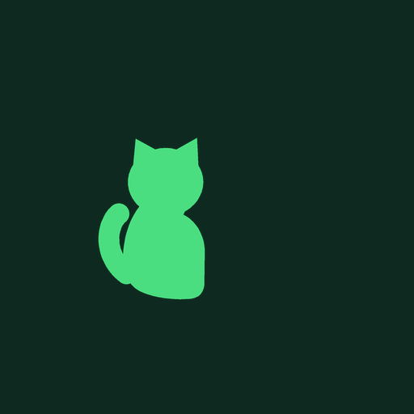
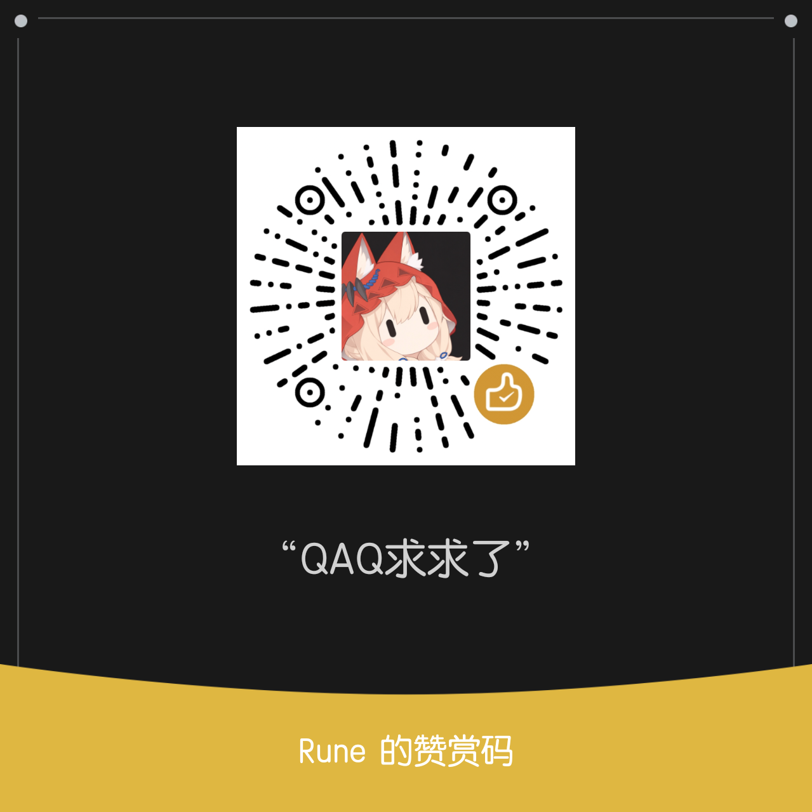

# MT论坛 客户端

<p align="center">
  
</p>

<p align="center">
  <b>bbs.binmt.cc</b> 的第三方 Android 客户端 · Jetpack Compose + Miuix · 原生 Kotlin
</p>

## 应用图标

启动图标只有 vector，没有一张位图：`res/drawable/ic_launcher_{background,foreground,monochrome}.xml`
加 `res/mipmap-anydpi-v26/ic_launcher{,_round}.xml`。图案是一只坐在**左下角**的简易猫，
右上留白给角标；猫的最远像素压在 33dp 安全区半径内（实测 30.6dp），Android 13+ 的主题图标
复用同一份几何走 `<monochrome>`。预览由 `python tools/render_app_icon.py` 直接渲染这些 XML
生成，不经过任何设计工具（上面那张就是它渲染出来的启动图标本身）。


## 简介

`MT论坛`（包名 `io.rune.mt.forum`）是 [bbs.binmt.cc](https://bbs.binmt.cc/forum.php)
的第三方 Android 客户端，用它看帖、发帖、回帖和收私信，界面跟着 HyperOS 走：
OS3 窗口 / OS4 玻璃两套风格、动态取色、模糊与预测式返回。

站点的官方移动 API 已经下线（一律 502），所以客户端不调 API，而是**解析 HTML**；
帖子正文由模板在服务端渲染成 HTML，客户端用 Compose `AnnotatedString` 忠实还原，
不套 WebView。

### 功能

| 模块 | 说明 |
|---|---|
| 论坛首页 | 版块宫格、站点原生「热帖排行」Top-10（与论坛主页同序）、可分页的「最新主题」帖子流 |
| 导读 | 最新 / 热门 / 精华 / 回复 / 抢沙发 五个视图，各自分页 |
| 版块列表 | 置顶/推荐/有图/热门标签、缩略图、作者头像、分页；主题分类筛选 |
| 帖子详情 | 楼层（楼主/回复区分）、富文本正文（代码块/标题/引用/表格/附件/表情/块级对齐/表头与合并列/可点击链接）、正文可选文字、OP 推荐数 |
| 附件 | 「下载到本机 / 浏览器打开 / 复制链接」三选；付费附件先提示「下载将扣除 N 金币」，下载走 attachcredit 两跳 |
| 回复 | 悬浮按钮、引用上一楼、论坛表情（3 组 257 个）、OS4 玻璃 / OS3 窗口底部面板（关闭即丢弃，无草稿） |
| 发新帖 | 标题 + 正文 + 表情 + 图片：**MT 图床**（`img.binmt.cc`，原图直传并插入 `[img]`）默认，或站点附件 1MB/张；**服务器草稿**（`save=1`）可列表、编辑、发表、删除 |
| 私信 | 会话列表、气泡、收发消息；正文支持 BBCode（共享工具栏 + 预览），`添加图片` 走图床 |
| 收藏 / 关注 / 顶 | 帖子页溢出菜单一键收藏、关注楼主、推荐本帖（成功后刷新 OP 赞数）；复制链接、浏览器打开、系统分享 |
| 个人主页 / 我的收藏 | 头像、等级、积分、统计与最近发表；收藏列表 + 取消收藏（登录后） |
| 搜索 | 论坛内关键词搜索（登录后）：**入口只有首页顶栏放大镜**，覆盖层带最近搜索（本地保存、可清除） |
| 消息 / 提醒 | 私信 + 系统提醒 / 回复我的 / 我的帖子，点行进对应帖子 |
| 每日签到 | 首页右上角入口（登录后）：今日排名 / 连续 / 累计，已签到置灰，服务器文案原样提示 |
| 评论屏蔽 / 板块管理 | 关键词屏蔽回复（默认保留楼主，可临时显示、页脚显示屏蔽数）；板块**顺序与隐藏**即时生效（本机设置） |
| 图片查看 | 帖子内图片点击全屏，双指缩放、拖动、双击复位 |
| 深链 | `thread-*.html` / `forum-*.html` / `forum.php?mod=` / `forum.php` 与 `mtforum://home` 回首页 / `mtforum://` |
| MCP 服务 | 设置里开关的本机回环 MCP 服务器（`POST /mcp`，JSON-RPC 2.0）：只读的版块 / 主题 / 楼层 / 搜索，见 [docs/MCP.md](MCP.md) |
| 主题 | OS3 / OS4 双风格、动态取色、HyperOS 预测式返回；主题模式用示例应用的「预览卡片 + 跟随系统」 |

### 尚未实现

- **评论正则屏蔽**：规则入口（关键词 / 正则切换）已经存在，但正则匹配目前不生效，按关键词屏蔽是可靠的；
  这是已知缺陷，后续修复。
- 会话过期自动重登（现在表现为只读：能看帖，不能回帖）
- 编辑 / 删除自己的帖子
- 提醒页未读态（站点当前不输出未读标记）
- 图片上传的进度与多图压缩

## 具体架构

### 数据流

```
             ┌──────────────────────────────┐
 bbs.binmt.cc│ ForumHttpClient              │  OkHttp
 ───────────▶│  ├ AcwInterceptor            │  挑战页 → 签名 → 重放
             │  └ Dispatchers.IO            │  阻塞调用切线程
             └───────────────┬──────────────┘
                             │ HTML
             ┌───────────────▼──────────────┐
             │ ForumHtmlParser (jsoup)      │  版块 / 列表 / 帖子 / 楼层 / 分页
             └───────────────┬──────────────┘
                             │ 领域模型
             ┌───────────────▼──────────────┐
             │ ForumRepositoryImpl          │
             │  ├ ForumCookieJar            │  内存会话
             │  ├ ForumSessionStore         │  DataStore 持久化
             │  └ ForumPasswordAuthenticator│  账号密码登录
             └───────────────┬──────────────┘
                             │ StateFlow
             ┌───────────────▼──────────────┐
             │ ForumViewModel               │  首页 / 列表 / 帖子 / 导读 / 回复
             └───────────────┬──────────────┘
                             │ Compose State
             ┌───────────────▼──────────────┐
             │ Miuix 页面（OS3 / OS4 自适应）│
             └──────────────────────────────┘
```

分层依赖是单向的：**网络层不认识 UI，UI 层不拼 DOM**。三个关注点各自独立，任一出问题先定位层次
（抓 `ForumHttpClient` 的日志，看拿到的是不是真实页面）：

1. **反爬** — `AcwSignature` + `AcwInterceptor`：无签名请求会拿到 4 KB 的 JS 挑战页，拦截器识别后
   计算 `acw_sc__v2`（`hexXor(unsbox(arg1), KEY)`）、下发 Cookie 并重放，上层无感。
2. **解析** — `ForumHtmlParser`：站点 DOM 的唯一知识来源，选择器改动必须同步
   `app/src/test/resources/forum/` 的真实页面样本。
3. **渲染** — `ForumBodyParser` + `ForumHtmlText`：HTML → Compose 块（代码块、表格按内容加权列宽、
   相册列表、附件卡、可点链接），行内样式映射为 `SpanStyle`。

### 代码地图

| 路径 | 职责 |
|---|---|
| `data/forum/network/` | 反爬、HTTP、multipart、HTML 解析、URL 规则、附件下载 |
| `data/forum/repository/` | 仓库实现：会话、登录、草稿、签到、评论屏蔽、板块偏好 |
| `domain/forum/` | 领域模型、仓库接口、纯函数（匹配器、板块合并） |
| `ui/page/forum/` | 首页 / 列表 / 帖子 / 导读 / 私信 / 发帖 / 登录 / 正文渲染 |
| `ui/page/miuix/` | 设置、主题、关于、共享组件（顶栏、底部面板、对话框、卡片） |
| `data/mcp/` + `domain/mcp/` | 应用内 MCP：JSON-RPC 分发、回环 socket、工具目录 |
| `docs/`（本目录） | 交接、逆向规格、架构、构建环境、MCP 规格 |

### 正文渲染

站点把帖子存成 BBCode、由 Comiis 模板在服务端渲染成 HTML，客户端拿到的是 HTML，任务是忠实还原：
行内 `strong`/`i`/`u`/`s`/`a`/`font color` 映射为 `SpanStyle`；`font[size]` 变成标题层级；
`div.comiis_blockcode` 整块保留行结构与等宽排版（可复制）；`div.comiis_quote` 带作者页眉；
`ul/ol`（不限层数）、`table/tr/th|td`（表头 + `colspan`、列宽按内容加权）、块级 `[align]`、
可点击 `<a>`、附件卡片各有专属块。按论坛自带教程（thread 161119）补的保真度：
`[list=1]`/`[list=a]` 的有序列表（服务端是 `<ul type>`）、`[media]`/`[audio]`/`[flash]` 的
诚实媒体卡、`[email]` 的 `mailto:` 可点、`[qq]` 聊天行。完整审计见
[docs/BBCODE_TUTORIAL_AUDIT.md](BBCODE_TUTORIAL_AUDIT.md)。

### 线程与风格

所有网络与解析都在 `Dispatchers.IO` 上执行，`MainThreadSafetyTest` 是静态回归守卫。
UI 只用 Miuix：唯一风格开关是 `AppTheme.useMiuixOs4`（OS4 还要 `isRenderEffectSupported()` 守卫），
`MiuixStyleGuardTest` 扫描源码防止玻璃 / 窗口组件的跨风格泄漏。界面细节对齐官方示例应用
（`example/`）：玻璃顶栏只采样页面内容层、长列表叠滚动条、连续行画成一张分组卡片。

### 构建与验证

构建交给 GitHub Actions（`../.github/workflows/build.yml` 每次 push 出 APK，
`manual-stable-release.yml` 手动发 stable 版），本地不需要配环境：

```bash
bash tools/build.sh :app:testStableDebugUnitTest   # 全量单测
bash tools/build.sh :app:lintVitalStableRelease    # 改字符串 / 资源后必跑
```

当前基线：**78 个 suite / 481 个用例**，覆盖 acw 签名（与 JS 参考实现交叉验证）、页面解析、
登录表单、正文富文本、Compose 真实渲染、主线程安全、图片会话隔离、图床两步上传、MCP JSON-RPC 等。
本机跑不了模拟器，UI 用 Robolectric 截成 PNG 验证（产物在 `app/build/ui-screenshots/`），
样例见 [screenshots/](screenshots/)。环境要求见 [docs/BUILD_ENV.md](BUILD_ENV.md)
（JDK 25、Android SDK 37.2、Gradle 9.8.1）。

### 文档

- [docs/HANDOVER_CN.md](HANDOVER_CN.md) — 交接文档（架构、约定、已知问题）
- [docs/REVERSE_SPEC.md](REVERSE_SPEC.md) — 站点逆向规格
- [docs/ARCHITECTURE.md](ARCHITECTURE.md) — 代码地图
- [docs/MCP.md](MCP.md) — 应用内 MCP 服务（端点、JSON-RPC、工具、安全边界）
- [docs/BUILD_ENV.md](BUILD_ENV.md) — 构建与测试环境
- [AGENTS.md](../AGENTS.md) — 面向 AI 代理的开发约定

## 免责声明

- 本项目是**个人开发的第三方客户端**，与 MT论坛（bbs.binmt.cc）及其运营方没有任何隶属、授权或合作关系，
  不代表站点立场，也不承担站点的任何服务责任。
- 客户端只做「请求站点页面 + 解析展示」：账号与密码由用户直接提交给站点本身，**App 不落盘任何凭据**；
  会话 Cookie 仅保存在本机，用于维持登录。论坛数据、内容与版权的归属仍属于站点与原作者。
- 站点随时可能改版、加验证或调整限制，届时部分功能会失效；因使用本客户端导致的账号异常、数据丢失或
  其他损失，由使用者自行承担。
- 「MT论坛」「MT」等名称与标识归其权利人所有，本项目仅在描述用途时提及。
- 本项目以 **GPL-3.0** 发布（见 [LICENSE](../LICENSE)），按「现状」提供，不附带任何明示或暗示的担保。

## 赞赏

感谢您对此项目的支持喵！如果此项目对您有帮助，可以通过微信赞赏码进行赞赏喵！

<p align="center">
  
</p>

赞赏完全自愿，不影响任何功能——所有功能都是免费的。